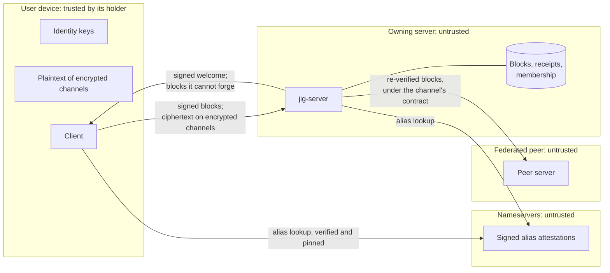
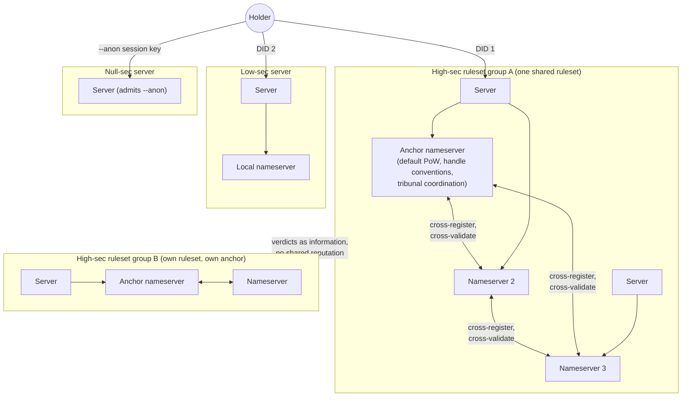
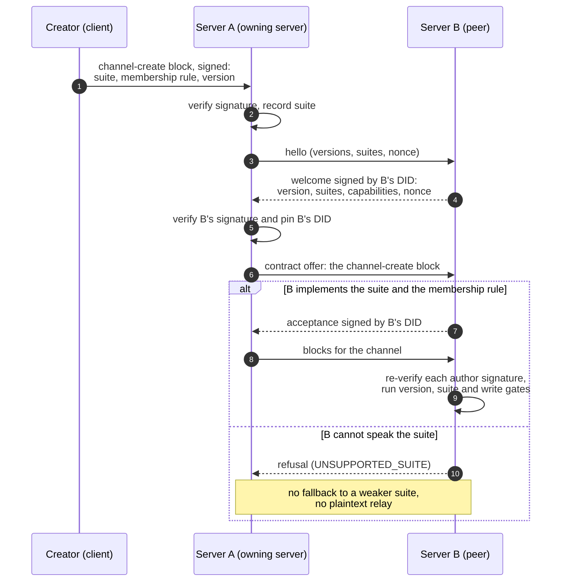

# Trust, federation and identity in jig

A whitepaper on how jig decides whom to believe: self-certifying identity, names, `--anon`,
reputation, security levels and ruleset groups, nameservers and anchors, federation as a data
contract, pluggable encryption, abuse handling, tribunals, and the threats each of these has to
survive.

**Status:** non-normative. Written 2026-10-16 against `main` at v0.2 (M2); status lines
updated 2026-10-18 for the hardening PRs #90 to #95. The
specification in [`repos/jig-spec/`](../../repos/jig-spec/) is normative and terse; this
paper explains the design and the reasoning behind it (decision D18). Where the two
disagree, the spec wins and this paper is out of date.

**Audience:** protocol contributors, server and nameserver operators, and security
reviewers. No familiarity with the codebase is assumed, but the paper cites code so that
claims about what exists can be checked.

---

## Contents

1. [How to read this paper](#1-how-to-read-this-paper)
2. [The problem: no trusted party](#2-the-problem-no-trusted-party)
3. [Identity](#3-identity)
4. [Names and nameserver attestation](#4-names-and-nameserver-attestation)
5. [`--anon` and unlinkability](#5---anon-and-unlinkability)
6. [Reputation](#6-reputation)
7. [Security levels and ruleset groups](#7-security-levels-and-ruleset-groups)
8. [Nameservers in a ruleset group, and anchors](#8-nameservers-in-a-ruleset-group-and-anchors)
9. [Federation as a data contract](#9-federation-as-a-data-contract)
10. [Pluggable encryption](#10-pluggable-encryption)
11. [Malicious operators and the handshake](#11-malicious-operators-and-the-handshake)
12. [Abuse handling without backdoors](#12-abuse-handling-without-backdoors)
13. [Tribunals](#13-tribunals)
14. [Threat analysis beyond operators](#14-threat-analysis-beyond-operators)
15. [Summary: obligation, today, gap](#15-summary-obligation-today-gap)
16. [Design agenda](#16-design-agenda)

---

## 1. How to read this paper

jig is pre-alpha. Most of what this paper describes is not built, and some of what is built
is a prototype that explores a requirement without meeting it. A reader must be able to tell
the requirement from the prototype at every point. So each topic in sections 3 to 13 has
three parts, always in this order:

| Part | What it holds |
| --- | --- |
| **Obligations** | What jig must guarantee to fulfil its vision, written as requirements independent of today's code. An obligation is not weakened because nothing implements it yet, and a prototype's behaviour never defines one. |
| **Today (v0.2)** | What the code on `main` does, with paths so it can be checked. Blunt about prototypes and gaps. |
| **To be designed** | The open problems between the two, including known weaknesses that must be fixed before the obligation can be claimed. |

- In **Obligations**, each item ends with where it is settled:
  - a numbered decision in the roadmap's [decisions log](../ROADMAP.md#decisions-log) (D1,
    D11, D12, D19, …), including D20 to D24 on `--anon`, reputation scope, encrypted abuse
    reports, the nameserver obligations with the server/nameserver split, and channel
    ownership (listed in [section 16.1](#161-decisions-recorded));
  - **maintainer**, the security-level model the maintainer set out in review of the
    identity spec and earlier drafts of this paper, not yet numbered in the log;
  - a design document, a roadmap principle, or a threat-register entry;
  - **derived**, a requirement that follows from the vision but has not been formally
    decided. The design agenda lists these for confirmation.
- In **Today**, each item is **Built** (in the tree and doing what it says), **Partial**
  (some of it is built, and the text says which part is not), **Prototype** (code that
  explores the shape of an obligation, does not meet it, and is not the design), **None**,
  or, for an obligation that requires an absence, **Holds** (for example, no backdoor
  exists).
- In **To be designed**, each item is **Proposed** (a candidate this paper puts forward;
  nothing depends on it) or **Open** (no candidate yet). **Known weakness** marks a flaw in a
  prototype or a candidate that must be fixed in full before the obligation is claimed.

The threat families in [section 14](#14-threat-analysis-beyond-operators) (AB, SC, PV, NS,
GV, TM) are entries in the spec's [threat register](../../repos/jig-spec/src/threat-register.md),
beside the operator entries OP-01 to OP-10. The register uses the same split: its *Decision*
column states the obligation, and its *v0.2* column states today. The register holds the
decisions; this paper holds the analysis.

### 1.1 Terms

These words carry precise meanings throughout.

- **Holder.** A person, organisation or agent that holds keys.
- **DID.** A `did:jig` identifier, which is an ed25519 public key. A holder may hold many.
- **Alias.** A human-readable name such as `alice@example.jig`, mapped to a DID by a
  nameserver that signs the mapping.
- **Server.** The execution and enforcement boundary. A server looks clients up by DID and
  deals with them under policies it presets and the client agrees to
  ([section 8](#8-nameservers-in-a-ruleset-group-and-anchors)).
- **Nameserver.** A service that attests aliases. Inside a ruleset group, its nameservers
  also keep the group's shared registry, hold its tribunals, compute and enforce net
  reputation changes, and enforce servers' good behaviour.
- **Ruleset.** A published, versioned document, named by its hash, that states how
  identities are registered, what is enforced, what proof-of-work costs, how reputation
  moves, how unknown keys are treated, and who judges disputes.
- **Ruleset group.** One concrete group of servers, clients and nameservers that have all
  agreed to be rated by the same ruleset, whose rules produce the same reputation maths for
  every member. Reputation, penalties and registrations are shared within one ruleset group.
  Interop between groups, by translation under a data contract, is possible but comes later.
  A server with no nameserver sets its own policy.
- **Security level.** A category describing how demanding a ruleset is: **high-sec**,
  **low-sec** or **null-sec** ([section 7](#7-security-levels-and-ruleset-groups)). A level
  describes a ruleset, and so the servers and groups that apply it; never a user. It is a
  description, not a party: two high-sec ruleset groups share a level and nothing else
  unless they agree a translation, and nothing is pooled across a security level.
- **Trusted subnet.** A set of servers whose operators trust each other, such as one
  organisation's sites, that agree to share federation contracts
  ([section 9](#9-federation-as-a-data-contract)).
- **Anchor nameserver.** A nameserver that gives a new high-sec ruleset group its initial
  coordination ([section 8](#8-nameservers-in-a-ruleset-group-and-anchors)). Joining is
  opt-in, and an anchor has no veto.
- **Owning server.** The one server that owns a channel
  ([section 9](#9-federation-as-a-data-contract)).
- **Tribunal.** A ruleset group's process for judging disputes under its ruleset
  ([section 13](#13-tribunals)).

Older drafts and some code use "zone" for a security level, for a group of servers, and for
a tier users graduate through. This paper uses the word only to name that superseded code.

---

## 2. The problem: no trusted party

Anyone can run a jig server, and anyone can run a nameserver. A design that is safe only
when those parties are honest is not safe at all, because users cannot tell an honest
operator from one that has been compromised, coerced or sold. So jig starts from the
position that **no infrastructure party is trusted**, and asks what a user can still rely
on. This section states that premise once; every later section inherits it as an obligation.

**Secure by default against hostile operators.** Malicious server operators are in scope
(D11). A hostile operator controls its binary, its storage, its keys, its network position
and its configuration, including which nameserver it consults. It cannot forge a signature
by a key it does not hold, make two blocks share a CID, or read content encrypted to a group
it is not in. A hostile federated peer is the same attacker one hop further away. The full
model and the evidence for each operator entry are in
[`docs/security/operator-threat-model.md`](../security/operator-threat-model.md).

**The same stance covers everyone else**: nameservers, other users, the code users run, and
the people who judge disputes. A party the protocol cannot vet is assumed hostile.

What must survive untrusted infrastructure is a short list:

1. **Signatures.** A block accepted by a client was signed by the DID it names.
2. **Content addressing.** A block's CID is a BLAKE3 hash of its contents, so a block cannot
   be altered without changing its name.
3. **Fail-closed negotiation.** A client that does not get the answers it needs, signed,
   refuses to continue.
4. **End-to-end encryption.** On an encrypted channel the server relays ciphertext it
   cannot read.
5. **Attribution.** A lie in a signed answer is evidence against whoever signed it.

Everything else, including delivery, ordering, completeness and metadata, is something a
hostile operator can degrade. The design says so rather than implying otherwise. v0.2 is a
partial implementation of this list; the *Today* part of each section says how partial.

### Non-goals

- **Metadata privacy.** Routing needs sender, channel and timing. Hiding them needs mixnets
  or private information retrieval, which conflict with "runs on a potato". v0.x makes no
  metadata-privacy claim (OP-04).
- **A global identity, a global reputation score or a global ledger.** No reputation input
  exists that an attacker cannot mint at some cost. A global score would be the most
  valuable thing on the network to forge, buy or capture, and whoever computed it would
  govern the network in practice.
- **Central governance.** No body, organisation or nameserver sets rules for the whole
  network.

### Trust boundaries

The diagram shows the target model. Section 4 and section 9 say which of these checks v0.2
makes.

Each arrow crosses a boundary where the receiver must check rather than trust: signatures on
blocks, the signature on the handshake, the author signature on relayed blocks, the
signature on alias attestations, and the contract a peer signed.

---

## 3. Identity

### 3.1 Obligations

1. **A DID is a key.** A jig identity is a self-certifying `did:jig`, an ed25519 public key.
   There is no account, no password, and nothing for a server or nameserver to issue or
   revoke. Anyone holding a DID can verify a signature by it with no lookup. *(Roadmap
   principle.)*
2. **The sender is the DID that signed.** Every decision about a block uses the DID its
   signature established, in one canonical spelling. A nickname or alias in a block is
   checked against that DID and never stands in for it. *(Derived; OP-08.)*
3. **Every state change is a signed block**, including channel and membership changes and
   alias registrations, so all state has the same audit trail as content. *(Roadmap
   principle: everything is a block.)*
4. **Many DIDs per holder, and nothing linking them.** Minting a DID is free. No protocol
   message links two DIDs; the only link between a holder's actions is a DID the holder chose
   to reuse. *(Server authentication design,
   [`2026-08-24-jig-server-authn-authz-design.md`](../superpowers/specs/2026-08-24-jig-server-authn-authz-design.md).)*
5. **A session is bound to one DID, and nothing is bound to the transport.** Binding to an IP
   address or a connection would correlate the holder with something they never chose to
   reveal. *(Server authentication design; PV-03.)*
6. **Authentication protects anonymity.** Even an anonymous reader proves possession of its
   key. A DID anyone can claim without the key is not anonymous, it is impersonable.
   *(Server authentication design.)*
7. **Keys stay cheap to discard.** Holders are expected to discard keys under pressure to
   de-anonymise, so minting and discarding must stay cheap, and a fresh DID must never be
   worse off than *unknown* ([section 6](#6-reputation)). *(Derived.)*

### 3.2 Today (v0.2)

- **Built.** A `did:jig` is the 32-byte ed25519 public key, base32-encoded with a `z` prefix
  ([`jig-core/src/did.rs`](../../repos/jig-core/src/did.rs)). `jig init` mints the key
  locally ([`jig-client/src/identity.rs`](../../repos/jig-client/src/identity.rs)) and stores
  it in `~/.jig/keys/` with owner-only permissions.
- **Built.** Ingest verifies the signature first, then uses the DID it established, in
  canonical spelling, for every later decision
  ([`jig-pipeline/src/ingest.rs`](../../repos/jig-pipeline/src/ingest.rs), steps 1 and 1b).
- **Partial.** Channel creation, member add, kick, leave and promotion are signed blocks
  that go through the same ingest path as a chat message. Alias attestations are not: a
  nameserver signs them but stores them as records
  ([`jig-nameserver/src/v0_0_2_register.rs`](../../repos/jig-nameserver/src/v0_0_2_register.rs)).
  The nameserver's block-kind allow-list reserves `ns-register`, `ns-rotate`, `ns-renew` and
  `ns-attestation`, and nothing uses them yet.
- **Partial.** No protocol message links two DIDs, and reads carry a signed proof of
  possession. Sessions are not bound to one DID: a v0.2 socket binds its read identity per
  subscription, so one socket can change identity. Each submitted block carries its own
  author's signature.
- **Partial.** An alias can move to a new key with proofs from both keys
  ([`v0_0_2_rotate_renew.rs`](../../repos/jig-nameserver/src/v0_0_2_rotate_renew.rs)). On
  encrypted channels the DID's key is the MLS signature key, so rotating it means rejoining
  every MLS group ([`docs/security/encryption.md`](../security/encryption.md)).
- **None.** Multi-device identity, and recovery after a key is lost. A lost key is a lost
  identity: its alias can be re-registered only after the attestation expires, and
  reputation held under the old DID does not transfer.

### 3.3 To be designed

- **Open.** Binding a session to one DID across a connection, on the read path as well as
  the write path.
- **Proposed.** Alias attestations become blocks, using the reserved kinds.
- **Open.** Multi-device identity, consistent with one DID being one MLS client today
  ([JEP-0001](../../repos/jig-spec/jep/jep-0001-encryption-suites.md), open question 4).
- **Open.** Recovery after loss. Any recovery scheme links an old key to a new one, so it
  must be a link the holder chose in advance, never one the protocol creates
  (obligation 4).

---

## 4. Names and nameserver attestation

A human wants to type `alice`, not a 61-character DID. Because a DID is its own key, it
cannot be substituted; what can be substituted is the mapping from a name to a DID. Names
are where key substitution happens (OP-08).

### 4.1 Obligations

1. **A name-to-DID mapping is a claim by whoever made it.** It is never a fact. It must be
   signed by its maker and checkable by the client, not only by the server. *(OP-08.)*
2. **Resolvers verify attestations.** A resolver accepts an attestation only from a
   nameserver authoritative for the alias's suffix, verifies its signature against that
   nameserver's DID, and never caches it past its validity. *(NS-01.)*
3. **Clients pin.** A client pins a name's DID and the server's DID on first sight and
   surfaces any change to the holder. *(OP-08.)*
4. **Equivocation is detectable.** Two validly signed attestations binding one alias to
   different DIDs in overlapping validity windows are proof of misbehaviour, and the system
   keeps what is needed to show it. *(NS-02.)*
5. **In a high-sec ruleset group, one alias maps to one DID across the group**, and no single
   nameserver can substitute a mapping. A disagreement between nameservers is detected and
   refused, never settled by whichever answered first. *(Maintainer; NS-03.)*

### 4.2 Today (v0.2)

- **Built: trust on first use.** In `[identity] mode = "tofu"`, the first DID seen with a
  local nickname is locked to it, and a later block claiming that nickname with another DID
  is refused ([`TofuResolver`](../../repos/jig-pipeline/src/identity.rs),
  [`h5_tofu_mismatch.rs`](../../repos/integration-tests/tests/h5_tofu_mismatch.rs)).
  Nicknames may not contain `@` or `:`, so a local nickname cannot impersonate a nameserver
  alias. The lock applies only to blocks that carry a nickname, and the antipattern flag
  `identity.naively_allow_unknown_handles_fallback` turns it off. TOFU suits small and
  private servers.
- **Built: nameserver attestation.** In `mode = "nameserver"`, the server resolves an alias
  such as `alice@example.jig` against one or more configured nameservers and refuses a block
  whose DID differs from the answer
  ([`NameserverResolver`](../../repos/jig-pipeline/src/identity.rs),
  [`h6_nameserver_mode.rs`](../../repos/integration-tests/tests/h6_nameserver_mode.rs)). To
  register, a client fetches a single-use challenge, signs it with the DID's key, and posts
  the signature with the requested alias. The nameserver checks the proof of control,
  refuses an alias already held by another DID, and returns an attestation it signs: DID,
  alias, nameserver DID and a validity window of 90 days. Renewal needs the same proof;
  rotation needs proofs from both keys.
- **Partial: the check is on the server.** TOFU stores its lock in the server's database,
  and the resolver caches answers in the server's memory. Either way the client trusts the
  server's check, which protects users from each other but not from the operator (OP-08).
  The CLI pins each server's DID on its first signed welcome (or first TLS probe) and
  refuses another, but it does not yet pin a name's DID
  ([`jig-client/src/pins.rs`](../../repos/jig-client/src/pins.rs)).
- **Partial: attestations are signed but not yet verified.** The server's resolver does not
  yet verify attestation signatures or suffix authority (NS-01).
- **Partial: "one or more nameservers" means failover, not agreement.** A second configured
  nameserver adds availability, not cross-checking.
- **None.** No resolver keeps the attestations it acts on, so equivocation leaves no
  evidence. Nameservers do not cross-register.

### 4.3 To be designed

- **Open.** How a resolver learns which nameserver is authoritative for a suffix: local
  configuration, the ruleset, or a signed delegation.
- **Proposed.** Verification of attestations, and expiry of cached answers, in the resolver
  and in clients.
- **Proposed.** A client pin store for names (the CLI's store for server DIDs and suites is
  built), and how a change is shown to the holder.
- **Proposed.** Resolvers keep the attestations they act on, and a ruleset group's
  transparency log ([section 8](#8-nameservers-in-a-ruleset-group-and-anchors)) makes
  equivocation public evidence.
- **Open.** Cross-registration mechanics in a high-sec ruleset group, in section 8.

---

## 5. `--anon` and unlinkability

### 5.1 Obligations

1. **`--anon` is a fresh, unregistered session key.** The client mints a key for the session,
   registers it nowhere, and discards it afterwards. It still signs and still proves
   possession: it is unregistered, not unauthenticated. *(D20.)*
2. **No protocol link between an `--anon` identity and a DID.** There is no in-protocol link
   between an `--anon` key and any other DID the holder holds, no warrant-based unmasking,
   and no escrowed mapping. Earlier drafts described a "dual" mode in which an anonymous
   persona and a verified one were linked, with the link revealable by a tribunal under
   warrant. That design is dropped: a link that exists can be compelled, stolen or leaked,
   and whoever holds the unmasking key becomes the most valuable target on the network. The
   only safe link is one that does not exist. *(D20.)*
3. **What a server does with an `--anon` key is server policy, and a separate question.**
   Whether a server looks the key up against a nameserver, and what it does with the result
   or its absence (admit it as unknown, ask for proof-of-work, allow reads only, refuse), is
   set by the server's ruleset. The protocol does not prescribe it, and nothing on the wire
   marks a key as `--anon`. *(D20.)*
4. **An `--anon` key carries no reputation beyond its session.** It is unknown everywhere
   ([section 6.1](#61-obligations)) and bears whatever cost the server's ruleset sets for
   unknown keys. *(Derived from 1.)*
5. **Clients do not link a holder's identities by accident.** The protocol can promise that
   no message links two DIDs; it cannot stop a client from doing so. A client must not make
   linking the default. *(Derived; PV-03.)*

Network-level correlation is out of scope. An observer who sees a holder's traffic to two
servers can link two identities by timing (PV-01). A holder who needs that protection needs
a network layer jig does not provide.

### 5.2 Today (v0.2)

- **None.** There is no `--anon` mode. `jig init` mints a persistent key and stores it under
  `~/.jig/keys/`; it registers an alias only when asked (`--request-alias`).
- **Prototype.** The nameserver's experimental surface mints `anon-` aliases. A minted alias
  is a registration, so it is not `--anon` as decided; it is a prototype of the anonymity
  obligations, not their design.
- **Built.** The server's admission policy admits unknown DIDs by default; refusing them is
  an explicit operator choice
  ([`jig-server/src/auth/admission.rs`](../../repos/jig-server/src/auth/admission.rs)).
- **Partial.** No protocol message links two DIDs, but sessions are not yet bound to one
  ([section 3.2](#32-today-v02)).
- **Partial.** The CLI keeps every key in `~/.jig/keys/` and every identity's plaintext cache
  under `~/.jig/mls/`, so a seized or compromised device links every identity on it (PV-03).

### 5.3 To be designed

- **Open.** The client's `--anon` mode: a key held in memory only, nothing written to disk
  (MLS state and plaintext included), and how such a key joins an encrypted channel whose
  key packages the owning server serves.
- **Open.** The vocabulary a ruleset uses for unknown keys, and how a server declares it in
  its signed welcome so a client knows the policy before it signs anything. On the wire an
  `--anon` key looks like any other fresh DID, so the policy is about unknown or
  unregistered keys, not about a flag. Today's admit-or-refuse setting for unknown DIDs is
  where such a policy would plug in.
- **Proposed.** Client measures against self-linking: a separate key store per identity or
  per ruleset group, never two identities in one session or on one connection, and a visible
  indicator of which identity is active.

---

## 6. Reputation

### 6.1 Obligations

1. **Reputation is one number per ruleset.** Under each ruleset that has observed it, a DID
   has a single number that behaviour moves up or down. There are no stages, ranks or tiers
   to graduate through; older drafts that moved users from null-sec to low-sec to high-sec by
   meeting thresholds are superseded. *(D21.)*
2. **A shared ruleset comes first.** The servers, clients and nameservers of a ruleset group
   all agree to be rated by the same rules, and those rules produce the same reputation maths
   for every member, so a number means the same thing wherever the group uses it.
   Reputation is never pooled across a security level: there is no "high-sec standing", no
   global scalar, and nothing an attacker can inflate everywhere at once. *(D21.)*
3. **Reputation is required, and its work is split.** Nameservers and a ruleset group's
   security posture do not work without it, together with proof-of-work, tribunals and
   transparency logs ([section 8](#8-nameservers-in-a-ruleset-group-and-anchors)). A server
   decides about the clients it serves by reputation, using its nameserver network's
   ruleset, a ruleset it keeps privately, or none, and reports reputation changes for those
   clients to the nameservers it belongs to. The nameservers compute and enforce the *net*
   change from every server's reports, not one server's marginal observation. *(D23.)*
4. **Unknown is not low.** A DID with no number under a ruleset is *unknown* for that
   ruleset. Floors never apply to it; only the ruleset's policy for unknown keys does. If
   unknown silently meant "below threshold", a holder who discarded a key under pressure
   would land on a fresh DID and be refused everywhere, punishing the behaviour the anonymity
   model depends on. *(Derived; admission design.)*
5. **Whitewashing is answered by cost, not by tracking.** A holder with a bad number can
   discard the key and start fresh. Tracking holders across keys would destroy the anonymity
   model, so instead a fresh DID starts unknown, and each ruleset decides what an unknown DID
   must show or spend before it is trusted. **No server owes anyone access.** *(Derived.)*
6. **No penalty under a ruleset you did not acknowledge.** No entity loses reputation under a
   ruleset it has not seen and acknowledged. *(Server authentication design; GV-03.)*
7. **Sybil and collusion resistance that holds.** Reputation must not be inflatable by many
   cheap identities, by vouching rings, by forged time or by colluding nameservers. The
   known attack classes are listed in section 6.3; each must be answered in full in the
   phase that builds reputation. *(D23; AB-05.)*
8. **Servers and nameservers carry numbers too**, under the rulesets that observe them. A
   signed lie, such as a false attestation, a false reputation report or a broken federation
   contract, moves the signer's number; that is where attribution earns its consequence.
   Nameservers enforce servers' good behaviour this way. *(Maintainer; D23.)*

### 6.2 Today (v0.2)

- **Partial.** Admission ("gate 2") is a pure function of the caller's DID, what the server
  knows about it, and what the operator decided: bans first, then reputation floors in order,
  and with no floors, the operator's choice about unknown DIDs (admit by default). It runs on
  reads and on locally submitted writes, before identity resolution and every channel lookup
  ([`jig-server/src/auth/`](../../repos/jig-server/src/auth/),
  [`ingest.rs`](../../repos/jig-pipeline/src/ingest.rs) step 1b).
- **Partial.** Scores are held as `ruleset key → score`, and floors name the ruleset they
  apply to. The scores are seeded from operator configuration (`[auth.admission] records`).
  Nothing computes them, servers report nothing to nameservers, and nothing is shared
  between servers.
- **Built.** The handshake's `reputation` field is signed and is `null`
  ([`handshake.rs`](../../repos/jig-pipeline/src/handshake.rs)).
- **Current rule (OP-10).** Reputation is not a protocol security input until
  [JEP-0003](../../repos/jig-spec/jep/jep-0003-server-discovery.md) defines it. An operator
  may use its own numbers on its own server; nothing relies on anyone else's. This is a
  sequencing rule for v0.x; it does not weaken obligation 3.
- **Prototype.** The nameserver's experimental surface
  ([`jig-nameserver/src/server.rs`](../../repos/jig-nameserver/src/server.rs)) records
  reputation observations and summaries, computes a per-nameserver aggregate, and adjusts
  proof-of-work difficulty by penalty. It parses rulesets and translation contracts but
  applies only a ruleset's proof-of-work multiplier, and it stores reputation gossip from
  peers without applying it. Its configuration models reputation as per-user
  `ReputationZone` tiers, the model obligation 1 supersedes. Neither the alias flow nor
  `jig-server` uses it. It is a prototype of
  obligations 3 and 7, not an implementation of them, and must not be relied on.
- **None.** Reputation inputs, decay, vouching, numbers for servers and nameservers, and
  ruleset acknowledgement.

### 6.3 To be designed

- **Proposed: inputs.** Each ruleset defines its own. Plausible ones: *up* for time in good
  standing measured by the ruleset group's clock, not the holder's (TM-01), useful work the
  group can verify, and vouching; *down* for verified abuse reports, failed or invalid
  proofs, tribunal verdicts, and protocol violations a server can prove; *decay* so penalties
  fade and a reformed holder can recover without minting a new key.
- **Proposed: acknowledgement.** The server authentication design places it in the trusted
  handshake: the server presents its ruleset keys, and the client acknowledges them. This
  paper adds that the acknowledgement be a block signed by the holder's DID that names the
  ruleset by hash, so "you agreed to these rules" is checkable later, in both directions.
  **Open:**
  whether acknowledgement is per server, per ruleset group or per ruleset version, and what
  happens to existing members when a ruleset changes.
- **Proposed: soul validation.** A holder stakes reputation on the claim that another DID is
  held by a distinct human. The vouched-for DID's gains are boosted, and its losses propagate
  back to the vouchers, weighted by the stake. Limits: it raises Sybil cost only if vouchers
  are themselves costly, so vouches from unknown or low-scored DIDs carry little weight; it is
  local to one ruleset; a vouch publicly links two DIDs, so a holder must never vouch with an
  identity they keep unlinked; and it must not become a gate, so a newcomer with no vouches is
  unknown, not refused. **Open:** boost and propagation weights, and how a vouch is withdrawn.
- **Known weakness: linear Sybil cost.** Any defence that charges a fixed price per identity,
  such as proof-of-work at registration, makes *n* identities cost *n* times one. An attacker
  with a botnet pays that price at a fraction of a legitimate user's marginal cost (AB-02),
  so per-identity cost alone does not hold. The nameserver prototype's penalty-adjusted
  proof-of-work is of this kind; the cost model behind its parameters is in
  [`docs/security/nameserver-abuse-economics.md`](../security/nameserver-abuse-economics.md).
  The design must make *standing* costly, not just *existence*, and must ensure that many
  cheap identities never add up to the standing of one costly one (AB-05).
- **Known attack classes the design must answer in full** (D23), each tied to
  a register entry: identity farming (AB-05); distributed solving of proof-of-work (AB-02);
  challenge replay and theft of solved challenges (AB-01); vouching rings and collusion
  between identities; whitewashing straight after a penalty; buying or renting aged keys,
  since standing attaches to a key and keys can be sold; fast-forwarded clocks (TM-01);
  colluding or equivocating nameservers (NS-02, NS-03); and capture of the panels that issue
  penalties (GV-01, GV-02).
- **Open: the reporting contract.** What a server's reputation report to its nameservers
  contains (subject, change, evidence by CID), how it is signed, and how nameservers combine
  reports from many servers into one net change that a single lying server cannot move far.
- **Open.** Who keeps the number for a nameserver, under which ruleset, and how a signed lie
  by a nameserver reaches it.
- **Later: interop between ruleset groups.** Translating one group's numbers into another's
  under a data contract both agreed to (the spec's translation contracts). Possible, but not
  a first priority (D21).
- **Open.** How reputation feeds the handshake's `reputation` field (JEP-0003).

---

## 7. Security levels and ruleset groups

### 7.1 Obligations

1. **A security level describes a ruleset, and so the servers and ruleset groups that apply
   it; never a user.** A user does not have a level. A user connects to servers, and each
   server applies a ruleset at some level. *(Maintainer.)*
2. **Sharing happens within a ruleset group.** Reputation, penalties, tribunal outcomes and
   registrations are shared among the servers and nameservers of one ruleset group, and never
   pooled across a security level. Interop between groups, by translation under a data
   contract, is possible but comes later. *(D21.)*
3. **Joining is opt-in, and leaving is always possible.** A server or nameserver joins a
   ruleset group by choice. A holder can always leave: they stop using that identity and
   connect elsewhere ("just fly out"). No ruleset group can follow a holder out, because none
   can link their next DID to their last, and the holder's reputation stays behind. There is
   no exit tax and no lock-in beyond the value of reputation the holder chose to build.
   *(Maintainer; D19.)*
4. **Different identities in different ruleset groups.** A holder can hold a cross-registered
   DID in a high-sec group for work, an alias on a low-sec community nameserver, and
   throwaway `--anon` keys on null-sec servers. What they do in one does not reach their
   standing in another. *(Maintainer.)*
5. **A server declares its ruleset, signed.** A client can learn, before it acts, which
   ruleset a server applies. A server that claims one ruleset and enforces another has signed
   the evidence against itself. *(Derived; OP-02.)*

What each level means, as a description of what rulesets at that level require:

| | High-sec | Low-sec | Null-sec |
| --- | --- | --- | --- |
| Identity registration | The group's nameservers cross-register identities; one alias maps to one DID across the group | A local nameserver, or TOFU | Not required; unregistered keys, `--anon` included, are typically admitted |
| Enforcement | Penalties and tribunal outcomes apply on every server in the group | Local to the server | Whatever the operator does, which may be nothing |
| Proof-of-work | Enforced by servers; difficulty is a ruleset parameter and may scale with reputation | Lighter; set by the server's ruleset | The server's choice |
| Reputation | One number per DID under the group's ruleset, shared within the group | Local to the server | Transient, at most per session |
| Character | Cross-validated, accountable | Community default | The IRC-like wild west |

The levels name points on a spectrum, not three products. "High-sec" names a kind of
ruleset; every high-sec ruleset group is separate from every other. The table describes
typical rulesets, not protocol rules: a server at any level decides how it treats `--anon`
and other unknown keys ([section 5.1](#51-obligations)).

The target model, which v0.2 does not yet implement:

### 7.2 Today (v0.2)

- **Partial.** The pieces a ruleset is made from exist in rough form on each server: identity
  mode (`tofu` or `nameserver`), the admission policy (bans, ruleset-scoped floors, the
  unknown-DID setting), and the block-kind allow-list. Nothing ties them into a declared
  ruleset, no server declares a level, and nothing is shared between servers.
- **Prototype.** The nameserver's experimental surface exchanges policy hashes and gossips
  with peers, and models reputation as per-user tiers (section 6.2). `jig-server` uses none
  of it.

### 7.3 To be designed

- **Proposed: ruleset declaration.** A server states its ruleset in its signed welcome: the
  ruleset keys it applies, the hash of the ruleset document, and where to fetch it. Instances
  also publish the hash and URL in `/.well-known/jig` as a discovery hint; the handshake is
  authoritative.
- **Open.** The ruleset document: what it must state (registration, proof-of-work parameters,
  reputation inputs, the unknown-key policy, the tribunal process), how it is versioned and
  signed, and how a ruleset group amends it.
- **Open.** How a server or nameserver joins and leaves a ruleset group, and what happens to
  state it shared while it was a member.

---

## 8. Nameservers in a ruleset group, and anchors

A nameserver maps aliases to DIDs and signs what it says. It is a convenience and a source
of accountability, not an authority. It cannot forge a user's signature; it can lie about
which DID a name belongs to, which is why its answers have to be signed, verified and, in
a high-sec ruleset group, cross-checked.

### 8.1 Obligations

1. **No nameserver is an authority.** A DID is valid without one. Every attestation is a
   claim by the nameserver that signed it, and a signed lie is evidence against it.
   *(Maintainer; NS-01.)*
2. **Four mechanisms are required, split between servers and nameservers.** Nameservers and
   a ruleset group's security posture do not work without proof-of-work, reputation,
   tribunals and transparency logs. These are obligations, not experiments to retire.
   Servers are the execution and enforcement boundary: a server looks clients up by DID and
   deals with them under policies it presets and the client agrees to. *(D23; spec:
   [Servers and nameservers](../../repos/jig-spec/src/identity-and-reputation.md#servers-and-nameservers).)*
   - **The server** enforces proof-of-work on the clients it serves. It decides about a
     client by reputation, using a ruleset recorded in its nameserver network, a ruleset it
     holds privately, or none. It reports reputation changes for the clients it works with
     to the nameservers it belongs to, as part of its data contract with them. It keeps its
     own transparency log of what it enforced and reported.
   - **The nameservers** hold the group's tribunals ([section 13](#13-tribunals)). They
     compute and enforce *net* reputation changes from every member server's reports, not
     one server's marginal observation ([section 6](#6-reputation)). They enforce servers'
     good behaviour, through servers' own numbers and penalties. Their transparency log
     records registrations, rotations, net reputation changes, penalties and verdicts, so
     equivocation and silent erasure are detectable (NS-02, NS-03).
   - **Proof-of-work** is a rate cost, never the only gate, and not by itself a Sybil
     defence (AB-02, AB-05). A nameserver's own binding endpoints, such as alias
     registration, are an ingress too and require it.
   - **A server with no nameserver** sets its own policy for all of this.
3. **Known attack classes are answered in full in the phase that builds them**, starting
   with linear Sybil cost; the list is in [section 6.3](#63-to-be-designed). A mechanism that
   leaves an applicable class open does not meet obligation 2. *(D23.)*
4. **In a high-sec ruleset group, nameservers cross-register.** The group's nameservers
   share their registries, so a registration on one is known to all. That gives one alias, one DID,
   group-wide; cross-validation, in which a single compromised nameserver produces a
   disagreement, not a substitution; and shared consequences, so a DID cannot abuse one
   server in the group and move to the next. *(Maintainer.)*
5. **No single nameserver decides a group-wide claim**, anchor included. One operator, even
   one running several nameservers, must not be able to make a claim authoritative alone.
   *(NS-03.)*
6. **Anchors are opt-in and have no veto.** A nameserver can anchor a high-sec ruleset group:
   it supplies the initial coordination a new group needs (default proof-of-work parameters,
   handle conventions such as the alias namespace and allowed characters, and tribunal
   coordination), so nobody has to bootstrap a group from scratch. Anyone can run their own
   groups with their own anchors, join an existing group, or skip groups entirely and simply
   connect to servers. **No nameserver, anchor included, has a veto or can control the
   network.** An anchor supplies defaults, not authority. *(D19.)*

### 8.2 Today (v0.2)

- **Built.** The alias flow (challenge, register, resolve, renew, rotate) in section 4.2.
- **None.** Nameservers do not coordinate or cross-register. There are no group-wide claims,
  no ruleset groups and no anchors.
- **Partial.** Servers can require one-time admission proof-of-work of unknown DIDs, off by
  default (D26). They report no reputation changes to nameservers and keep no transparency
  log.
- **None.** Registration through the alias flow (`/v1/register`, which `jig init` and
  `jig ns` use) has no proof-of-work and no rate limit. The experimental surface's own
  `claim` and `alias` endpoints, below, do apply them.
- **Prototype.** The nameserver binary also carries an earlier, experimental surface beside
  the alias routes
  ([`jig-nameserver/src/server.rs`](../../repos/jig-nameserver/src/server.rs)):
  proof-of-work challenges with penalty-adjusted difficulty
  ([`pow.rs`](../../repos/jig-nameserver/src/pow.rs)), reputation observations, tribunal case
  records, transparency-log storage with a chain verifier
  ([`transparency.rs`](../../repos/jig-nameserver/src/transparency.rs)) to which the running
  service writes no entries, policy-hash exchange and peer gossip. The alias flow and `jig-server` use none of it. It explores the shape of
  obligation 2 and meets none of it: its proof-of-work is per identity, its reputation model
  is the superseded tier model, and its log is kept by one nameserver with nobody
  cross-checking it. Treat it as a prototype of the obligations, not as the protocol, and do
  not rely on it.

### 8.3 To be designed

- **Proposed: a replicated registry.** Registrations and their changes are signed blocks,
  replicated among the group's nameservers, so each holds the full registry and any can
  detect a conflict.
- **Proposed: agreement thresholds.** A group-wide claim, whether "this alias belongs to this
  DID", "this DID registered on this date" or "this DID carries this penalty", is
  authoritative only when nameservers run by independent operators agree, at a threshold the
  ruleset fixes. Clients resolve against more than one nameserver and refuse on disagreement.
- **Open.** How a ruleset group establishes that its nameservers have independent operators
  without a central registry of operators (NS-03, GV-01), and what happens to a registration
  during a network partition.
- **Open: the server–nameserver data contract.** What a server agrees to when it joins a
  ruleset group (the reputation-report format, proof-of-work floors, publishing its log), what
  the nameservers owe it in return, and how a server that breaks the contract is penalised.
- **Open: transparency logs.** For servers and for nameservers: what else is logged, and in
  what form; who signs log heads; how a client checks inclusion and consistency; how personal
  data stays out of an append-only record; and how the logs of one group relate to another's
  (they do not merge).
- **Open: proof-of-work that holds.** Difficulty as a ruleset parameter scaled by reputation,
  applied per action as well as per identity, and paired with the defences in section 6.3 so
  that its linear cost is not the only barrier.
- **Proposed: "no veto" made structural.** An anchor's parameters are a signed document other
  nameservers adopt by choice, and a member can diverge from them. The anchor holds no state
  the group cannot rebuild, because the registry is replicated. It counts once in
  cross-validation and cannot meet the agreement threshold alone. Replacing it is an ordinary
  change of the group's ruleset. **Open:** what the ruleset needs to say for that, and how the
  defaults document is versioned and signed.
- **Known weakness.** The prototype's proof-of-work prices identities linearly (AB-05), its
  reputation, case records and log are local to one nameserver (NS-03), and its challenge
  proofs are not bound to an action or a DID (AB-01). Meeting obligation 2 means designing
  each mechanism against the attack classes first; whether any prototype code survives is an
  implementation question.

---

## 9. Federation as a data contract

### 9.1 Obligations

1. **A cross-server channel is a data contract over the transmission.** The contract fixes
   the channel's encryption suite when the channel is created. Each server implements suites
   itself; the contract fixes which one the channel uses. A server that cannot speak the channel's suite is refused, the way a TLS
   handshake with no common cipher suite fails: no fallback to a weaker suite and no
   plaintext relay. *(D12.)*
2. **Use cases and clients are not typed at this layer.** A chat server and an industrial
   orchestrator can carry one channel without knowing what the other is. Federation agrees on
   bytes, signatures and suite, and nothing about what the bytes mean. *(Roadmap principle.)*
3. **A channel has, by definition, one owning server.** *(D24.)*
4. **A peer is a transport, not a source of authority.** A receiving server re-verifies every
   relayed block's author signature and runs the same gates a local block passes before
   persisting it. *(OP-09 for authorship, version and suite; roadmap item 18 for the write
   gate; derived for the rest.)*
5. **Every promise in a contract is signed.** A server that accepts a contract and then
   breaks it has signed the evidence. *(Derived; OP-02.)*
6. **Trusted subnets may share a nameserver-led contract**, rather than negotiating pairwise.
   *(D12.)*
7. **Restricted and encrypted channels federate.** Two unlike servers federate a channel
   through the contract alone. *(D12; phase 1 exit criterion.)*

### 9.2 Today (v0.2)

- **Partial.** Federation is block relay over WebSocket between configured peers
  ([`jig-server/src/v0_0_2_federation.rs`](../../repos/jig-server/src/v0_0_2_federation.rs),
  [`h3_federation.rs`](../../repos/integration-tests/tests/h3_federation.rs)). A server dials
  each configured peer by URL, completes the same JEP-0002 handshake a client does, and
  subscribes with a request signed by its own server DID. A relayed block is re-verified
  against its author's signature and must pass the manifest's version and schema gates.
- **Built: a channel's suite is fixed at creation.** It is chosen by the creator, recorded
  in the signed `channel-create` block, fixed for the channel's life, and checked on every
  later post (`channels.suite`,
  [`jig-pipeline/src/mls_gate.rs`](../../repos/jig-pipeline/src/mls_gate.rs),
  [spec: Encryption](../../repos/jig-spec/src/encryption.md#channels)).
- **Partial: only open, unencrypted channels federate.** `DeliveryPolicy::federates` is true
  only for an open channel with suite `none`
  ([`jig-pipeline/src/fanout.rs`](../../repos/jig-pipeline/src/fanout.rs)). Restricted and
  encrypted channels' blocks never leave their server, and a relayed block for a local
  restricted or encrypted channel is refused.
- **Built: relayed blocks pass the gates a local block passes, with two exceptions.** A
  relayed block runs through `ingest` like a local submission: author signature, version and
  suite gates, admission, the write gate, effects, and the receiving server's own execution
  and receipt (OP-09). Its author is not asked for admission proof-of-work, and a relayed
  `text-render` may name a channel the receiving server has no record of. Only open, unencrypted channels federate because the federation contract (D12)
  does not yet say how one MLS group spans two servers.
- **Built: peers are pinned and listed.** A server accepts relayed blocks only over a
  connection it dialed to a listed peer whose welcome is signed by that peer's configured
  DID, and only listed peers may subscribe to its federation stream. Peer connections use
  TLS by default. Antipattern flags that weaken federation are off by default and listed in
  `/.well-known/jig` under `unsafe_options_active` when set.
- **None.** Channel and membership state do not replicate; each server keeps its own. There
  is no contract offer or acceptance, and no specification of how a member on one server
  writes to a channel another server owns.
- Federation has been exercised in tests and on private networks, never between two hosts on
  the public internet.

### 9.3 To be designed

- **Proposed: what the contract holds.** The creator-signed `channel-create` block plus each
  participating server's signed acceptance of it. The block names the channel's identity and
  protocol version, its owning server, its encryption suite, its membership rule (open,
  restricted or locked, and who may sign membership changes), how commits are ordered and
  validated on an encrypted channel, and optionally the ruleset under which members are
  judged. Acceptance is a statement signed by a server's DID that it implements the suite and
  will enforce the membership rule.
- **Open: cross-server writes to a channel.** A channel has one owning server; how a member
  whose home is another server writes to it is not specified. The maintainer considers this a
  solved problem in prior art, so the design starts with a survey, and this paper picks no
  answer. Systems to survey:
  - **XMPP multi-user chat (XEP-0045).** A room lives on one service; occupants on other
    servers join over server-to-server links, and the room's service orders and reflects
    messages.
  - **IRC.** A channel exists across a network of servers that share its state over a
    spanning tree, with no owner. Netsplits and the rules for merging after them show what a
    single owner avoids, and what it costs.
  - **Matrix.** Rooms are replicated across participating homeservers with no owner, and a
    state-resolution algorithm settles conflicts. A contrast case for what one owner gives
    up and gains.
  - **ActivityPub groups.** A group is an actor on one server; remote members address the
    group's inbox, and the group redistributes to its followers.

  The survey must answer, for jig: how a write reaches the owner and is attributed; who orders
  blocks and MLS commits, the owner or another party; what happens when the owner is unreachable or hostile
  (liveness, and censorship under OP-06); whether ownership can move; and how the contract
  records the owner.
- **Proposed: nameserver-led contracts for trusted subnets.** The nameserver signs a contract
  template naming the suites, versions and membership rules the subnet uses, and each server
  adopts it by signing it. Channels created inside the subnet inherit the template. A server
  that leaves the subnet stops honouring it, and the channels it was part of refuse it as they
  would any server not party to their contract.
- **Open.** Pinning a peer's DID as part of the contract rather than in each server's
  configuration. (Running relayed blocks through the write gate, with peers listed in
  configuration, is built: roadmap item 18.)

The contract handshake as proposed, with A as the channel's owning server:

Steps 1 to 5 exist today, with the peer's DID pinned in configuration
([section 11](#11-malicious-operators-and-the-handshake)). Everything after step 5 is the
proposal.

---

## 10. Pluggable encryption

### 10.1 Obligations

1. **Encryption is a pluggable suite, not a fixed scheme.** The envelope and every manifest
   carry a suite identifier. Adding a suite is a registry entry, a JEP and conformance
   vectors, never a wire-format change. *(D1;
   [JEP-0001](../../repos/jig-spec/jep/jep-0001-encryption-suites.md).)*
2. **MLS is the default and the first suite** ([RFC 9420](https://www.rfc-editor.org/rfc/rfc9420)).
   Suites are plug-and-play: an operator can run the Signal protocol, a post-quantum scheme or
   another suite. *(D1, D2, D13.)*
3. **Unknown or unimplemented suites are refused**, never treated as `none`, and a channel's
   suite is fixed at creation. *(OP-03.)*
4. **The server holds no group secret and never executes encrypted content.** *(OP-05,
   SC-03.)*
5. **End-to-end encryption by default.** Until it is the default, releases say plainly what
   is not encrypted. *(Roadmap product constraint 4.)*
6. **Honest about metadata.** v0.x makes no metadata-privacy claim, and the documentation
   says exactly what an operator can see. *(OP-04.)*

### 10.2 Today (v0.2)

- **Built.** MLS per channel
  ([spec: Encryption](../../repos/jig-spec/src/encryption.md), [`jig-mls`](../../repos/jig-mls/),
  [`scripts/demo-e2ee.sh`](../../scripts/demo-e2ee.sh)). One channel is one MLS group, and a
  DM is a channel with locked membership, so DM, group DM and channel are one scheme (D2). A
  leaf's credential names the member's DID, and its signature key must be that DID's key.
- **Built.** The server is a **validating delivery service** that holds no group secret. It
  tracks the group's public state and accepts a commit only if it is valid for the current
  epoch and does exactly what its block says.
- **Built.** Unknown and unimplemented suites are refused; a channel's suite is fixed at
  creation and enforced on every post (OP-03). The server executes nothing under an encrypted
  suite, and its receipt says `"content": "sealed"`.
- **Partial.** Restricted channels are always MLS (D25), and `jig dm` always creates an
  encrypted channel. An open channel created without a suite is plaintext to the operator,
  and a restricted channel created plaintext before D25 is frozen.
- **Partial.** Encrypted channels do not federate (section 9.2).
- **None.** A second suite, and conformance vectors per suite (JEP-0001, open question 8).

**What the operator sees.** Being precise matters more than sounding reassuring. On an
encrypted channel the operator **can** see and record:

- the sender DID, channel, time and size of every block;
- membership changes, including, from the commits it validates, who was added or removed
  and when;
- which DIDs read which channels and when, since reads carry a signed proof of possession;
- published MLS key packages, and the transport facts of every connection, such as IP
  addresses and connection times;
- for a federated peer, the same facts about everything relayed to it.

That is enough to build a social graph, an activity timeline and, with access to several
servers, cross-server correlations (PV-01). A legal demand served on an operator yields this
metadata.

The operator **cannot** read the content of an encrypted channel, forge or alter a block
without detection (clients verify every author signature), or decrypt messages sent before a
member joined. Membership changes arrive as commits that every member applies and sees. The
operator can join an *open* encrypted channel by external commit, like anyone, visibly to
every member. It can withhold, delay and reorder blocks (OP-06).

### 10.3 To be designed

- **Open (D13).** How a non-MLS suite such as the Signal protocol plugs in (group semantics,
  key distribution, conformance vectors), and whether post-quantum protection arrives as its
  own suite, as a hybrid MLS cipher suite, or both.
- **Open.** Making encryption the default for channels, not only for DMs.
- **Open.** Multi-device membership and key rotation (JEP-0001, open question 4).
- **Open.** Binding the handshake transcript into MLS group joins (JEP-0002, open
  question 4).
- **Open.** Client-side execution of decrypted content (JEP-0001, open question 7).
- **Open.** Encrypted channels across servers ([section 9.3](#93-to-be-designed)).

---

## 11. Malicious operators and the handshake

### 11.1 Obligations

1. **Every connection begins with a mandatory handshake, and clients fail closed** when it is
   missing, malformed or contradicted. The obligation sits on the client: a server-side "must
   send" binds only honest servers, while a client that will not proceed without a handshake
   binds every server. *(D11; [JEP-0002](../../repos/jig-spec/jep/jep-0002-handshake.md);
   OP-01.)*
2. **The server signs its answer.** A protocol cannot stop an operator lying, but it can make
   the lie attributable: a signed false answer is evidence a user, a peer or a ruleset group's
   reputation process can act on. Ruleset declarations (section 7), contract acceptances
   (section 9) and nameserver attestations (section 4) build on the same rule. *(OP-02.)*
3. **Later behaviour that contradicts a signed answer is a handshake failure.** *(OP-02.)*
4. **Clients pin the server's DID and the suites it advertised**, so substitution and
   downgrade are detected. *(OP-03, OP-08.)*
5. **The full handshake carries real suites and reputation.** *(D11.)*

### 11.2 Today (v0.2)

- **Built.** The client sends `hello` with the versions and suites it speaks and a fresh
  nonce. The server answers with a `welcome` signed by its DID key over the envelope version,
  the suites it can host (`none` and `mls`), its capabilities (allowed block kinds, whether it
  executes Wasm, whether it federates), the `reputation` placeholder and the client's nonce
  ([`jig-pipeline/src/handshake.rs`](../../repos/jig-pipeline/src/handshake.rs),
  [`jig-server/src/v0_0_2_ws.rs`](../../repos/jig-server/src/v0_0_2_ws.rs)). The server
  refuses any frame before `hello`. The client closes when the first frame is not a welcome,
  the signature or nonce does not verify, a pinned DID does not match, or the welcome
  contradicts itself or falls outside what the client offered.
- **Partial.** Version and suite refusals leave the connection open. Later frames are not
  checked against the welcome. The CLI pins each server's DID and the suites its welcome
  advertised, and each channel's suite from its signed creation block, but a server can
  still answer a device's first look at a channel with one it made up. `reputation` is
  `null`. Each gap is a Partial or Open entry in the register
  (OP-01 to OP-03, OP-08, OP-10).

### 11.3 To be designed

- **Open.** Which failures close a connection and which leave it open, and who closes it
  (JEP-0002, open question 6). Closing on every refusal would make ordinary mismatches look
  like attacks.
- **Open.** The rest of JEP-0002's questions: handshakes for stateless REST, re-handshake on
  reconnect, signed mid-session capability updates, and how a client reports a contradiction
  to the holder and to anyone else.
- **Proposed.** Ruleset declaration in the welcome (section 7.3).

---

## 12. Abuse handling without backdoors

### 12.1 Obligations

1. **No backdoors, no client-side scanning, no default key escrow.** Escrow exists only as an
   opt-in organisation policy for enterprise retention, never as a default and never as a
   network-wide mechanism. Scanning content on the client and reporting matches is a backdoor
   with extra steps: whoever controls the match list controls what is reported, and a hostile
   party can extend it. *(Roadmap, phase 5; maintainer.)*
2. **Abuse in encrypted channels must be reportable to a tribunal, with proof.** Every
   abusive incident involves at least two keys, the abuser's and the victim's. The victim can
   therefore delegate their key, or their view of the incident, to prove what happened. No
   third party needs access to the channel. *(D22; AB-06.)*
3. **On an encrypted channel, only participants can report.** No server, nameserver or
   tribunal can obtain encrypted content on its own. A report discloses what the reporting
   participant saw, and no more. *(Derived from 1 and 2.)*
4. **Authorship is provable.** Every block is signed by its author's DID, and on an encrypted
   channel the MLS content signature is made with the same key. That non-deniability is what
   makes an abuser's authorship provable to a tribunal. *(D22; PV-04.)*
5. **Every ingress applies its own limits**, using routing facts that need no content: rate
   limits and proof-of-work at servers, nameservers, bridges and relays. *(AB-03; Zero-Trust
   chapter of the spec.)*
6. **Refusal and exit stay available to everyone.** An operator can refuse a DID, a channel
   owner can remove a member, a server can defederate, and a holder can leave. *(Derived.)*

**The deniability trade-off.** Non-deniability cuts both ways. It is what lets a victim prove
that the abuser wrote what they received without anyone holding a key to the channel. It also
means that any message that is disclosed, whether by a recipient, a seized or compromised
device, or a coerced member, is attributable to its author by anyone, for as long as the DID
can be tied to the author. A holder who needs deniability has partial answers: a DID that is
not linked to them, such as an `--anon` key (section 5), so attribution reaches only a key;
and the absence of any protocol link between DIDs. A protocol that gave deniability, for
example by signing content with a key separate from the DID or by using deniable
authentication, would turn the victim's proof into a claim, so it would have to provide proof
some other way. jig chooses provable reporting and states its cost.

### 12.2 Today (v0.2)

- **Built.** An operator can ban DIDs, set reputation floors and refuse unknown DIDs at
  admission. A channel owner can kick a member, which on an encrypted channel commits them
  out of the group.
- **Partial.** Servers rate-limit every verified DID and, on their v0.0.2 routes, every remote address by default,
  and can require one-time proof-of-work of unknown DIDs at admission, off by default (D26).
- **Partial.** On a plaintext channel a block is signed by its author, so a forwarded block
  is verifiable evidence of who said it. On an encrypted channel the content signature is
  made with the DID key, so the property obligation 4 needs exists. No tooling exports a
  message with its signature, and there is no report format, no delegation mechanism and no
  tribunal to receive a report.
- **None.** Agent and bot declaration.

### 12.3 To be designed

- **Open: the reporting mechanism** (AB-06). Delegation of the victim's key or view, or
  another form of effective proof. Whatever the mechanism, it must:
  - prove that the abuser's DID signed this content, in this channel, at this point. In
    RFC 9420 a member's content signature covers the group context of its epoch, which a
    validating delivery service already tracks from public commits; that is a candidate basis
    for the proof, to be confirmed;
  - disclose only the incident, while giving a tribunal enough context not to be misled by
    selective disclosure, and letting the accused answer with their own disclosures;
  - if it delegates, scope the delegation to the incident and make it useless for anything
    else, so it can never act as a general key to the victim's channels;
  - be impossible for anyone but a participant to produce;
  - state what a tribunal accepts as evidence, and cover reports where the victim is a whole
    channel rather than one member.
- **Proposed: metadata-based limits.** Rate limits and proof-of-work on routing facts each
  ingress already sees (AB-02, AB-03).
- **Proposed: agent and bot declaration.** A DID can carry a signed, self-declared attribute
  saying it is automated and, optionally, which DID operates it. It cannot be enforced, since
  an undeclared bot looks like a person at the protocol level, but honest automation declares
  itself, a ruleset can require declaration and penalise proven non-declaration, and clients
  can label declared agents. Naming an operator DID publicly links two DIDs, so it is
  optional.

---

## 13. Tribunals

### 13.1 Obligations

1. **Tribunals are required, and nameservers hold them.** Nameservers and a ruleset group's
   security posture do not work without a way to judge disputes, so every ruleset group that
   shares penalties has a tribunal process, held by its nameservers. Servers bring cases and
   evidence; nameservers judge, and enforce the outcome as a net reputation change
   ([section 8.1](#81-obligations)). *(D23.)*
2. **Tribunals are per ruleset group.** Each group decides how it judges disputes under its
   own ruleset. Recognition across groups is voluntary: any group may adopt, weigh or ignore
   another group's verdicts, which arrive as information, not instructions. There is no court
   above the groups and no central governance body. *(Maintainer; GV-01.)*
3. **Penalties apply only under an acknowledged ruleset, and only within the ruleset group
   that adopted it.** *(GV-03; D21.)*
4. **Eligibility to judge does not rest on how many identities a party holds.** *(GV-02.)*
5. **Verdicts are attributable and cite their evidence.** *(Derived; GV-01.)*
6. **Tribunals can receive proof of abuse in encrypted channels** through the mechanism in
   section 12, and no other way. *(D22.)*

### 13.2 Today (v0.2)

- **None.** No tribunal exists in the protocol. The only consequences in the tree are local
  operator decisions (admission bans and floors in `[auth.admission]`) and channel owners'
  kicks.
- **Prototype.** The nameserver's experimental surface keeps tribunal case records
  (section 8.2). They are records, not a tribunal, and nothing consumes them.

### 13.3 To be designed

- **Proposed: the shape of a tribunal process.**
  - **Cases and verdicts are signed blocks** that cite their evidence by CID. A verdict that
    does not cite evidence is not a verdict.
  - **Panels are drawn from the ruleset group**, with eligibility that does not count
    identities (GV-02), drawn across nameserver operators where possible so no operator
    supplies a majority (GV-01).
  - **One appeal**, to a panel with no members of the first.
  - **Transparency**: the group publishes verdicts with personal data redacted, in its
    transparency log, so other groups can decide whether to recognise them.
  - **Defederation** of a server or nameserver requires published evidence and a
    supermajority within the group. It is the strongest sanction, and without a high bar it
    becomes a tool for capture.
  - **Policy publication**: each instance publishes its ruleset hash and URL, so what a group
    enforces is checkable against what it says.
- **Open.** Panel eligibility that holds against a patient attacker (GV-02). Standing over
  time, vouching and draws across operators all fall to patience eventually; the aim is that
  capturing a group costs more than leaving it and starting another.
- **Open.** How a verdict moves the reputation number, and how it decays.

---

## 14. Threat analysis beyond operators

Each subsection covers one family in the
[threat register](../../repos/jig-spec/src/threat-register.md). For each entry, *Obligation*
restates the register's decision, *Today* its v0.2 status, and *To design* what closes the
gap.

### 14.1 Abuse and Sybil (AB)

[Register: AB](../../repos/jig-spec/src/threat-register.md#abuse-and-sybil-ab).

- **AB-01, challenge replay.** A challenge that can be used twice is a coupon an attacker can
  resell, and once challenges carry proof-of-work a solved one is worth stealing.
  *Obligation:* challenges are single-use and short-lived, and a proof covers the action, the
  alias and every DID involved. *Today:* the nameserver consumes each challenge on first use
  and expires it after 60 seconds, but proofs are not bound to an action or a DID; read
  proofs carry a timestamp window and a nonce record that never evicts a live nonce
  ([`jig-server/src/auth/replay.rs`](../../repos/jig-server/src/auth/replay.rs)). *To
  design:* the binding, for every challenge-consuming action.
- **AB-02, botnet proof-of-work.** A botnet solves puzzles at a fraction of a legitimate
  user's marginal cost, and difficulty high enough to stop it locks out phones and potatoes.
  *Obligation:* servers enforce proof-of-work on the clients they serve, at the cost their
  ruleset sets, and a nameserver requires it on its own binding endpoints; it is never the
  only gate and never on its own evidence that an identity is one person (D23). *Today:*
  servers rate-limit every verified DID and, on their v0.0.2 routes, every remote address by default, and can
  require one-time admission proof-of-work of unknown DIDs, off by default (D26); the
  nameserver's binding endpoints (register, rotate, renew) have neither proof-of-work nor a
  rate limit, and the nameserver prototype's proof-of-work is unused. *To design:*
  reputation-scaled difficulty, per action as well as per identity.
- **AB-03, relay and bridge quota abuse.** Bridges and relays connect unidentified sources to
  identified users; a botnet emailing a known jig user through a bridge is the canonical
  case. *Obligation:* every ingress applies its own limits, and a relayed block stays
  attributable to its author and to the relaying server. *Today:* authors are attributable by
  signature, peers only by URL; the per-DID rate limit applies to a block's author whatever
  ingress carried it, but no limit is kept per peer or per bridge. *To design:* per-ingress
  limits and peer DID attribution (section 9.3).
- **AB-04, over-broad capability requests.** *Obligation:* capabilities are granted only as
  named in the manifest and attenuated at each nesting level, with no ambient authority.
  *Today:* the server executes only its own canonical `text-render` module. *To design:*
  matters from phase 2 (executable blocks).
- **AB-05, identity farming.** A defence that charges per identity grows only linearly with
  the number of identities, which an attacker with many machines pays cheaply.
  *Obligation:* Sybil resistance holds against farming, not just prices it: a fresh DID
  starts unknown, standing is earned under the ruleset over time the group measures, and many
  cheap identities never add up to the standing of one costly one. *Today:* no mechanism; the
  nameserver prototype prices identities linearly. *To design:* section 6.3, against every
  listed attack class.
- **AB-06, unprovable abuse in encrypted channels.** If abuse in an encrypted channel cannot
  be proven, abusers retreat into encryption; if it is policed by a backdoor, everyone loses
  encryption. *Obligation:* a participant in the incident can prove it to a tribunal by
  delegation or disclosure, with no backdoor, escrow or scanning, and no one else can.
  *Today:* the content signature that makes proof possible exists; no report format,
  delegation or intake does. *To design:* section 12.3.

### 14.2 Supply chain (SC)

[Register: SC](../../repos/jig-spec/src/threat-register.md#supply-chain-sc).

- **SC-01, malicious connector blocks.** *Obligation:* a connector that runs as a block is
  exactly what its CID names, signed by its author, runs with only its manifest's
  capabilities, and is pinned by CID so it cannot update silently. *Today:* bridges are Rust
  code compiled into the server ([`repos/bridges/`](../../repos/bridges/)), so they share the
  binary's trust and this is a code-review risk. *To design:* connectors as blocks, from
  phase 2.
- **SC-02, SDK and dependency substitution.** *Obligation:* the reference implementation
  depends only on this workspace and public crates, and release artifacts are signed and
  checksummed and verified by installers. *Today:* [`deny.toml`](../../deny.toml) refuses
  unknown registries and git sources. Release tarballs ship with a signed `SHA256SUMS`;
  `install.sh` verifies it against a pinned key and refuses to install without `ssh-keygen`,
  unless the user opts into a checksum-only install with `JIG_VERIFY_SIGNATURE=0`. No release is published,
  and builds are not reproducible. *To design:* reproducible builds, so a user can check a
  binary against the source.
- **SC-03, Wasm runtime zero-days.** *Obligation:* the sandbox is one layer of several:
  execution is fuel-metered, memory-bounded and capability-gated, a host executes only
  modules it chose, and a server never executes encrypted content. *Today:* the server
  executes only its canonical module, encrypted blocks get a `sealed` receipt, and advisories
  are checked daily. The residual risk, an escape in the runtime itself, is answered by
  patching quickly, not by design.

### 14.3 Privacy (PV)

[Register: PV](../../repos/jig-spec/src/threat-register.md#privacy-pv).

- **PV-01, federation timing correlation.** A block relayed across servers appears on each at
  nearly the same time, and so does a holder's activity under two DIDs on two servers.
  *Obligation:* no unlinkability claim against an observer of several servers (OP-04);
  identities a holder keeps apart are unlinkable only as distinct DIDs used in uncorrelated
  sessions. *Today:* accepted. A network layer outside the protocol is the only answer.
- **PV-02, receipt linkage.** Receipts are evidence by design, so they also record which
  servers handled which block and when. *Obligation:* a receipt for encrypted content carries
  no render hash or other content-derived value. *Today:* `sealed` receipts carry no
  `render_hash`; the linkage itself is accepted.
- **PV-03, identity cross-linking.** *Obligation:* no protocol message links two DIDs, a
  session is bound to one DID, and clients keep identities used in different ruleset groups
  apart. *Today:* no message links DIDs, but sessions are not bound to one DID and the CLI
  keeps every identity under `~/.jig/`. *To design:* sections 3.3 and 5.3.
- **PV-04, non-deniability.** *Obligation:* every block is signed by its author's DID, and on
  an encrypted channel the MLS content signature uses the same key, so content is
  attributable by anyone it is disclosed to. This is deliberate: it is what makes abuse
  provable (AB-06), so jig makes no deniability claim for content signed by a DID. It is a
  design choice, not a v0.x limit. *Today:* as stated. The trade-off is in section 12.1.

### 14.4 Malicious nameservers (NS)

[Register: NS](../../repos/jig-spec/src/threat-register.md#malicious-nameservers-ns).

- **NS-01, false or poisoned resolution.** *Obligation:* accept an attestation only from a
  nameserver authoritative for the alias's suffix, verify its signature, never cache past its
  validity; clients pin (OP-08). *Today:* attestations are signed and expire, but the
  server's resolver does not verify them, does not bind suffixes to nameservers, and takes
  the first answer. *To design:* section 4.3.
- **NS-02, equivocation.** A nameserver that tells one asker that `alice` is DID 1 and another
  that she is DID 2 is not caught by signature checks, because both answers are validly
  signed. *Obligation:* two such attestations with overlapping validity are proof of
  misbehaviour; resolvers keep the attestations they act on, and a ruleset group's
  nameserver transparency log records every registration (D23). *Today:* nothing keeps
  attestations, and nothing writes to a log. *To design:* transparency logs (section 8.3).
- **NS-03, collusion on clock or state.** Facts shared across a ruleset group, such as when a
  DID registered or what penalty it carries, are only as good as the agreement behind them.
  *Obligation:* no single nameserver, anchor included, decides a group-wide claim.
  *Today:* nameservers do not coordinate. *To design:* agreement thresholds and operator
  independence (section 8.3).

### 14.5 Governance (GV)

[Register: GV](../../repos/jig-spec/src/threat-register.md#governance-gv).

- **GV-01, tribunal capture.** Whoever controls a group's panels controls its consequences.
  *Obligation:* tribunals are per ruleset group and held by its nameservers (D23), and no
  group is bound by another's verdict.
  Per-group tribunals bound the damage: a captured group can harm only those who stay in it
  and groups that recognise its verdicts, and both can leave. *Today:* no tribunal protocol.
  *To design:* section 13.3.
- **GV-02, Sybil panels.** If eligibility counts identities, the party with the most DIDs
  wins. *Obligation:* eligibility does not rest on the number of identities. *Today:* none.
  *To design:* eligibility that holds against patience (section 13.3).
- **GV-03, penalty propagation without consent or evidence.** Shared consequences are what
  make high-sec ruleset groups useful and what make them dangerous. *Obligation:* no
  reputation loss under an unacknowledged ruleset, and penalties propagate only within the
  ruleset group that adopted the ruleset, citing a verdict or evidence (D21). Other groups
  receive verdicts as information, and translation between groups comes later.
  *Today:* bans and floors are local operator configuration. *To design:* acknowledgement
  (section 6.3) and verdict blocks (section 13.3).

### 14.6 Time (TM)

[Register: TM](../../repos/jig-spec/src/threat-register.md#time-tm).

- **TM-01, clock-skewed farms.** An attacker running many machines with fast-forwarded clocks
  can make an identity look old, or slip through time-windowed limits, if anyone believes the
  claimant's clock. *Obligation:* time-based limits use the verifier's clock, and age is
  measured from the first signed observation by someone other than the subject. *Today:*
  replay windows use the server's clock; there are no time-based reputation limits; the
  server's hybrid logical clock adopts timestamps from blocks without a skew bound, which it
  advertises as `naively_unbounded_clock_skew` in `/.well-known/jig`. *To design:* a skew
  bound, and age as observed by the group.
- **TM-02, self-asserted timestamps.** *Obligation:* a signer's own timestamp is a claim, so
  ordering and age come from others. *Today:* a block's `hlc_ts` is set by its author, inside
  the signed manifest, and the server orders history by it; the only server-signed time is
  the receipt's `produced_at`. *To design:* countersigned time; in a ruleset group, NS-03's
  agreement applies to time as to any shared fact.

---

## 15. Summary: obligation, today, gap

| Obligation | Today (v0.2) | Gap / to design |
| --- | --- | --- |
| A DID is a self-certifying ed25519 key; the sender is the DID that signed | Built: `did:jig`, minted locally; ingest uses the canonical DID | None for the core; multi-device and recovery open |
| Every state change is a signed block | Partial: channel and membership changes are blocks; alias attestations are records | Attestations as blocks |
| Many DIDs per holder, nothing linking them; one DID per session | Partial: no message links DIDs; a socket can change read identity | Session binding; client key-store separation (PV-03) |
| Names are signed claims, verified and pinned by clients | Partial: attestations signed; resolver ignores the signature; the CLI pins server DIDs but not names' DIDs | Suffix authority, verification, client pins (NS-01, OP-08) |
| Equivocation is detectable | None | Attestation retention, transparency log (NS-02) |
| `--anon` is a fresh, unregistered session key with no protocol link to any DID (D20) | None: no `--anon` mode; unknown DIDs admitted by default (admission proof-of-work is optional) | Client mode with nothing on disk |
| What a server does with `--anon` is server policy | Partial: only the unknown-DID setting (admit, refuse, or proof-of-work) | Ruleset vocabulary for unknown keys, declared in the welcome |
| Reputation is one number per ruleset; a ruleset group's members are rated by the same rules and maths; never pooled across a security level (D21) | Partial: `ruleset key → score`, seeded by the operator; nothing shared | Inputs, decay, sharing within a group, acknowledgement; interop between groups later |
| Sybil and collusion resistance that holds against known attack classes | None; prototype prices identities linearly | Every attack class in section 6.3 answered in full (AB-05) |
| Servers enforce PoW, decide by reputation, report changes to their nameservers and keep a transparency log; nameservers hold tribunals, compute net reputation and police servers (D23) | Partial at servers: rate limits on by default, one-time admission PoW off by default; no reputation decisions, reports or log; prototype in the nameserver, unused | Server–nameserver data contract; each mechanism designed against the attack classes (section 8.3) |
| Security levels belong to servers and ruleset groups; servers declare their ruleset, signed | Partial: per-server building blocks; no declaration | Ruleset document, declaration in the welcome, joining and leaving |
| High-sec nameservers cross-register; no single nameserver decides a group-wide claim | None: nameservers do not coordinate | Replicated registry, thresholds, operator independence (NS-03) |
| Anchors are opt-in with no veto (D19) | None | Structural "no veto"; anchor replacement |
| Federation is a data contract fixing the channel's suite (D12) | Partial: suite fixed per channel; relay of open, unencrypted channels only | Contract contents and signed acceptance |
| One owning server per channel (D24) | None: each server keeps its own channel state | Cross-server writes: survey XMPP MUC, IRC, Matrix, ActivityPub groups |
| A peer is a transport; relayed blocks pass every gate | Built: relayed blocks run through `ingest` and the write gate (authors not asked for admission proof-of-work); peers listed and pinned in configuration | Peer DID in the contract; per-peer limits |
| Pluggable suites, MLS default and first (D1, D13) | Built: MLS per channel; validating delivery service | Non-MLS plug-in shape (D13); per-suite conformance |
| End-to-end encryption by default | Partial: DMs and restricted channels always encrypted; open channels plaintext unless created `mls` | Encryption on by default |
| Mandatory signed handshake; clients fail closed and pin | Partial: signed welcome with nonce; CLI pins server DIDs, suites and channel suites; later frames unchecked | Close semantics; pins; real reputation (D11) |
| No backdoors, no scanning, no default escrow | Holds: no backdoor, scanning or escrow exists | Keep it so as reporting is designed |
| Provable abuse reports from encrypted channels, by participants only (D22) | None: signature exists; no tooling | Delegation or proof mechanism (AB-06) |
| Tribunals per ruleset group, held by its nameservers; penalties only under an acknowledged ruleset | None; prototype case records unused | Tribunal process, eligibility (GV-01 to GV-03) |
| Time-based limits use the verifier's clock | Partial: replay windows only; unbounded skew in the HLC | Skew bound; observed age (TM-01, TM-02) |

---

## 16. Design agenda

### 16.1 Decisions recorded

Settled before this paper and cited throughout:

- **D1, D2, D13:** encryption is a pluggable suite; MLS is the default and the first suite;
  how a non-MLS scheme plugs in is D13, still open.
- **D11:** malicious operators are in scope; mandatory signed handshake (JEP-0002); clients
  fail closed.
- **D12:** federation is a data contract that fixes the channel's suite; trusted subnets may
  share a nameserver-led contract.
- **D19:** anchor nameservers give a high-sec ruleset group initial coordination; joining is
  opt-in, no nameserver has a veto, and anyone can run their own.

Decided by the maintainer on 2026-10-16 and 2026-10-17, and numbered in the roadmap's
[decisions log](../ROADMAP.md#decisions-log):

- **D20: `--anon`** is a fresh, unregistered session key. Whether a server looks it up
  against a nameserver, and what it does with the result or its absence, is server policy, a
  separate question. There is no protocol link between an `--anon` identity and a DID.
- **D21: reputation** is one number per ruleset. The servers, clients and nameservers of a
  ruleset group agree to be rated by the same rules, which produce the same reputation maths.
  It is never pooled across a security level. Interop between groups, by translation under a
  data contract, is possible but comes later.
- **D22: encrypted abuse reports** to a tribunal are required, by delegation or effective
  proof: every incident involves at least the abuser's and the victim's keys, so the victim
  can delegate their key or view. The MLS content signature by the DID key makes authorship
  provable, at the cost of deniability. The mechanism is to be designed.
- **D23: proof-of-work, reputation, tribunals and transparency logs are obligations**, and
  the known weaknesses (linear Sybil cost and the other known attack classes) must be
  addressed in full. Servers are the execution and enforcement boundary: they enforce
  proof-of-work, decide about clients by reputation (a ruleset in their nameserver network,
  a private one, or none), report clients' reputation changes to their nameservers under the
  data contract, and keep their own transparency log. Nameservers hold tribunals, compute and
  enforce net reputation changes, and enforce servers' good behaviour. A server with no
  nameserver sets its own policy. Today's code is a prototype of these obligations.
- **D24: a channel has one owning server.** Cross-server writes are not specified; prior art
  is to be surveyed before choosing.

### 16.2 Agenda

Each item names what it must satisfy and the register entries it closes.

1. **Sybil and spam resistance that holds.** Make standing, not existence, costly; answer
   every attack class in section 6.3 in full. Closes AB-02, AB-05; feeds GV-02.
2. **Transparency logs and the server–nameserver data contract.** Server and nameserver log
   contents, signed heads, inclusion and consistency checks, personal data; the reputation
   reports servers send and how nameservers net them. Closes NS-02; feeds NS-03, GV-03.
3. **Cross-registration in high-sec ruleset groups.** Replicated registry, agreement
   thresholds, operator independence without a central registry, partitions. Closes NS-03.
4. **The ruleset.** Document format, versioning, declaration in the signed welcome,
   acknowledgement (per server, per group or per version), amendment, joining and leaving a
   group. Closes GV-03; feeds OP-02.
5. **Reputation.** Inputs, decay, net computation at nameservers, numbers for servers and
   nameservers, soul-validation weights and withdrawal, and the handshake field (JEP-0003).
   Later: translation between ruleset groups. Feeds OP-10.
6. **Encrypted abuse reports.** Delegation or proof, scoped to the incident, producible only
   by participants, with rules for what a tribunal accepts. Closes AB-06.
7. **Tribunals.** Process, panel eligibility, appeals, publication, defederation. Closes
   GV-01, GV-02.
8. **Cross-server channel writes with one owning server.** Survey XMPP MUC, IRC, Matrix and
   ActivityPub groups; then decide how writes reach the owner, who sequences MLS commits, and
   what happens when the owner is unreachable or hostile. Feeds OP-06.
9. **The federation contract.** Contents, signed acceptance, peer DID pinning in the contract,
   nameserver-led templates. Closes OP-09; feeds AB-03.
10. **`--anon` and unknown keys.** The client mode, and the ruleset vocabulary for unknown
    keys. Feeds PV-03.
11. **Client identity hygiene and pins.** Separate key stores, session binding, name and
    server pins. Closes PV-03, OP-08, NS-01.
12. **Suites.** The non-MLS plug-in shape (D13), per-suite conformance, multi-device and
    recovery, encryption on by default. Feeds OP-03, OP-05.
13. **The handshake.** Close semantics and JEP-0002's other open questions. Closes OP-01 to
    OP-03.
14. **Anchors.** Replacement procedure, and the signed, versioned defaults document.
15. **The nameserver prototype.** Decide what happens to the experimental surface (keep it,
    put it behind an opt-in flag, or remove it) until the redesigned mechanisms of items 1, 2,
    5 and 7 land. It is a prototype of those obligations, not their design, and the
    obligations stay whatever happens to the code.
16. **Housekeeping.** Confirm the obligations still marked *derived*.
