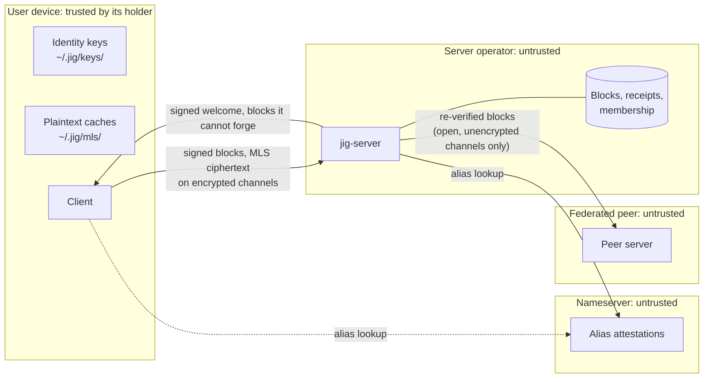
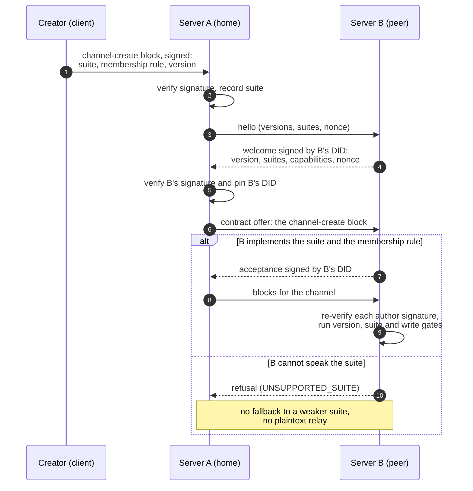

# Trust, federation and identity in jig

A whitepaper on how jig decides whom to believe: self-certifying identity, reputation,
security zones, nameserver federations, federation as a data contract, and the threats
each of these has to survive.

**Status:** non-normative. Written 2026-10-16 against `main` at v0.2 (M2). The
specification in [`repos/jig-spec/`](../../repos/jig-spec/) is normative and terse; this
paper explains the design and the reasoning behind it (decision D18). Where the two
disagree, the spec wins and this paper is out of date.

**Audience:** protocol contributors, server and nameserver operators, and security
reviewers. No familiarity with the codebase is assumed, but the paper cites code so that
claims about what is built can be checked.

---

## Contents

1. [How to read this paper](#1-how-to-read-this-paper)
2. [The problem: no trusted party](#2-the-problem-no-trusted-party)
3. [Identity](#3-identity)
4. [Reputation](#4-reputation)
5. [Security zones](#5-security-zones)
6. [Nameserver federations and anchors](#6-nameserver-federations-and-anchors)
7. [Federation as a data contract](#7-federation-as-a-data-contract)
8. [Pluggable encryption](#8-pluggable-encryption)
9. [Malicious operators and the handshake](#9-malicious-operators-and-the-handshake)
10. [Abuse handling without backdoors](#10-abuse-handling-without-backdoors)
11. [Governance: tribunals per zone](#11-governance-tribunals-per-zone)
12. [Threat analysis beyond operators](#12-threat-analysis-beyond-operators)
13. [Summary: built, decided, proposed](#13-summary-built-decided-proposed)
14. [Open questions](#14-open-questions)

---

## 1. How to read this paper

jig is pre-alpha, and much of what follows is design rather than code. To keep the two
apart, every substantive claim carries one of these labels:

| Label | Meaning |
| --- | --- |
| **[Built]** | In the tree on `main` today. A code or spec path is cited so it can be checked. |
| **[Built, in part]** | Some of it is in the tree; the text says which part is not. |
| **[Decided]** | A settled design decision, usually numbered in the roadmap's decisions log (D1, D11, …). Not built, or only partly built. |
| **[Decided, pending confirmation]** | The direction the project is taking, not yet formally confirmed by the maintainer. |
| **[Proposed]** | A design this paper puts forward. Open to change; nothing depends on it yet. |
| **[Open]** | A question nobody has answered. Collected in [section 14](#14-open-questions). |

The threat families in [section 12](#12-threat-analysis-beyond-operators) (AB, SC, PV, NS,
GV, TM) are entries in the spec's [threat register](../../repos/jig-spec/src/threat-register.md),
alongside the operator entries OP-01 to OP-10. The register holds the decisions; this paper
holds the analysis.

---

## 2. The problem: no trusted party

Anyone can run a jig server, and anyone can run a nameserver. A design that is safe only
when those parties are honest is not safe at all, because users cannot tell an honest
operator from one that has been compromised, coerced or sold. So jig starts from the
position that **no infrastructure party is trusted**, and asks what a user can still rely on.

**[Decided]** Malicious server operators are in scope (D11). A hostile operator controls its
binary, its storage, its keys, its network position and its configuration, including which
nameserver it consults. It cannot forge a signature by a key it does not hold, make two
blocks share a CID, or read content encrypted to a group it is not in. A hostile federated
peer is the same attacker one hop further away. The full model and the evidence for each
operator entry are in [`docs/security/operator-threat-model.md`](../security/operator-threat-model.md).

This paper extends the same stance to nameservers, to other users, to the code users run,
and to the people who judge disputes.

What survives an untrusted infrastructure is a short list:

1. **Signatures.** A block accepted by a client was signed by the DID it names.
2. **Content addressing.** A block's CID is a BLAKE3 hash of its contents, so a block cannot
   be altered without changing its name.
3. **Fail-closed negotiation.** A client that does not get the answers it needs, signed,
   refuses to continue.
4. **End-to-end encryption.** On an encrypted channel the server relays ciphertext it
   cannot read.
5. **Attribution.** A lie in a signed answer is evidence against whoever signed it.

Everything else, including delivery, ordering, completeness and metadata, is something a
hostile operator can degrade. The design says so rather than implying otherwise.

### Non-goals

- **Metadata privacy.** Routing needs sender, channel and timing. Hiding them needs mixnets
  or private information retrieval, which conflict with "runs on a potato". v0.x makes no
  metadata-privacy claim (OP-04).
- **A global identity, a global reputation score or a global ledger.** No reputation input
  exists that an attacker cannot mint at some cost. A global score would be the most
  valuable thing on the network to forge, buy or capture, and whoever computed it would
  govern the network in practice.
- **Central governance.** No body, organisation or nameserver sets rules for the whole
  network.

### Trust boundaries

Each arrow crosses a boundary where the receiver should check rather than trust:
signatures on blocks, the signature on the handshake, the author signature on relayed
blocks, and, once NS-01 is closed, the signature on alias attestations.

---

## 3. Identity

### 3.1 A DID is a key

**[Built]** A jig identity is a `did:jig`: the 32-byte ed25519 public key itself, encoded in
base32 with a `z` prefix ([`jig-core/src/did.rs`](../../repos/jig-core/src/did.rs)). The
client mints the key locally (`jig init`,
[`jig-client/src/identity.rs`](../../repos/jig-client/src/identity.rs)) and stores it in
`~/.jig/keys/` with owner-only permissions. There is no account, no password and nothing
for a server to issue or revoke.

Because the identifier is the key, a DID cannot be substituted: anyone holding a DID can
verify a signature by it with no lookup. What can be substituted is the mapping from a
human-readable name to a DID, which is why names get their own treatment below.

**[Built]** **The sender is always the DID.** Every block is signed over its canonical
bytes. Ingest verifies the signature first, then uses the DID the signature established,
in canonical spelling, for every later decision
([`jig-pipeline/src/ingest.rs`](../../repos/jig-pipeline/src/ingest.rs), steps 1 and 1b).
A nickname or alias in a block's metadata is checked against that DID; it never stands in
for it. One sender, one canonical DID string, whatever spelling the block carried.

**[Built, in part]** **Every state change is a signed block.** Channel creation, member
add, kick, leave and promotion are signed blocks that go through the same ingest path as a
chat message, so channel state has the same audit trail as content. Alias attestations are
the exception: a nameserver signs them but stores them as records, not blocks
([`jig-nameserver/src/v0_0_2_register.rs`](../../repos/jig-nameserver/src/v0_0_2_register.rs)).
**[Proposed]** They become blocks too; the nameserver's allow-list already reserves the
kinds (`ns-register`, `ns-rotate`, `ns-renew`, `ns-attestation`).

### 3.2 Names: TOFU or nameservers

A human wants to type `alice`, not a 61-character DID. A server chooses one of two ways to
check that a name belongs to the DID that used it.

**[Built]** **Trust on first use.** In `[identity] mode = "tofu"`, the first DID seen with a
local nickname is locked to it, and a later block claiming that nickname with another DID
is refused ([`TofuResolver`](../../repos/jig-pipeline/src/identity.rs),
[`h5_tofu_mismatch.rs`](../../repos/integration-tests/tests/h5_tofu_mismatch.rs)).
Nicknames may not contain `@` or `:`, so a local nickname cannot impersonate a nameserver
alias. The lock applies only to blocks that carry a nickname, and the antipattern flag
`identity.naively_allow_unknown_handles_fallback` turns it off. TOFU suits small and
private servers.

**[Built]** **Nameserver attestation.** In `mode = "nameserver"`, the server resolves an
alias such as `alice@example.jig` against one or more configured nameservers and refuses a
block whose DID differs from the answer
([`NameserverResolver`](../../repos/jig-pipeline/src/identity.rs),
[`h6_nameserver_mode.rs`](../../repos/integration-tests/tests/h6_nameserver_mode.rs)). To
register, a client fetches a single-use challenge, signs it with the DID's key, and posts
the signature with the requested alias. The nameserver checks the proof of control,
refuses an alias already held by another DID, and returns an attestation it signs: DID,
alias, nameserver DID and a validity window of 90 days. Renewal needs the same proof.
Rotation to a new key needs proofs from both the old and the new key
([`v0_0_2_rotate_renew.rs`](../../repos/jig-nameserver/src/v0_0_2_rotate_renew.rs)).

Three gaps matter for the threat model:

- **The check is on the server.** TOFU stores its lock in the server's database, and the
  nameserver resolver caches answers in the server's memory. Either way the client trusts
  the server's check, which protects users from each other but not from the operator
  (OP-08). **[Decided]** Pins move to clients. The handshake code checks a pinned server DID
  when the caller supplies one ([`jig-pipeline/src/handshake.rs`](../../repos/jig-pipeline/src/handshake.rs)),
  but the CLI records no pins yet.
- **The resolver does not verify the attestation.** `NameserverResolver` reads the `did`
  field of the response and ignores the signature beside it, and it does not tie an alias's
  suffix to the nameserver authoritative for it (NS-01).
- **"One or more nameservers" means failover, not agreement.** The resolver asks each
  configured nameserver in order and takes the first answer. A second nameserver adds
  availability, not cross-checking. Cross-checking is what high-sec zones add
  ([section 6](#6-nameserver-federations-and-anchors)).

The nameserver binary also serves an earlier, experimental surface by default
([`jig-nameserver/src/server.rs`](../../repos/jig-nameserver/src/server.rs)): proof-of-work
challenges with penalty-adjusted difficulty, reputation observations, tribunal case records,
a transparency log, policy-hash exchange and peer gossip. Its configuration still models
reputation as per-user zones, the tier model section 4 supersedes. The alias flow that
`jig init` and `jig ns` use, and that `jig-server` resolves against, uses none of it. Read
that surface as a prototype, not as the protocol this paper describes.

### 3.3 One DID per sender, many identities per holder

**[Decided]** A *holder* (a person, an organisation, an agent) may hold as many DIDs as it
likes. Minting one is free, and nothing in the protocol links two of them. The only thing
that links a holder's actions is a DID they chose to reuse. A session should be bound to
one DID, and nothing should be bound to the transport, because binding to an IP address or
a connection would correlate the holder with something they never chose to reveal. This
comes from the server authentication design
([`docs/superpowers/specs/2026-08-24-jig-server-authn-authz-design.md`](../superpowers/specs/2026-08-24-jig-server-authn-authz-design.md)).
**[Built, in part]** No protocol message links two DIDs. A v0.2 socket binds its read
identity per subscription, so one socket can change identity, and each submitted block
carries its own author's signature.

Two consequences are deliberate:

- **Anonymity attaches to the holder, not to a machine.** A holder can keep one DID for
  work, one for a hobby community and one for a null-sec channel, and nobody can tell they
  are the same holder unless the holder says so. Keys are expected to be discarded under
  pressure to de-anonymise, so minting and discarding them must stay cheap.
- **Authentication protects anonymity.** Even an anonymous reader proves possession of its
  key. A DID anyone can claim without the key is not anonymous, it is impersonable.

### 3.4 `--anon` and unlinkability

**[Decided, pending confirmation]** jig has **no in-protocol link between an `--anon`
identity and a live DID**, and no warrant-based unmasking. Earlier drafts described a
"dual" identity mode in which an anonymous persona and a verified one were linked, with the
link revealable by a tribunal under warrant. That design is dropped: a link that exists can
be compelled, stolen or leaked, and whoever holds the unmasking key becomes the most
valuable target on the network. The only safe link is one that does not exist.

**[Proposed]** What `--anon` means:

- The client mints a fresh key for the session, registers it nowhere, and discards it
  afterwards. It still signs and still proves possession; it is unregistered, not
  unauthenticated.
- It carries no reputation beyond the session, so it bears whatever entry cost the server
  sets for unknown DIDs.
- Servers that admit `--anon` identities sit in null-sec ([section 5](#5-security-zones)).
  Admitting unknown DIDs is the default of the server's admission policy today; refusing
  them is the explicit operator choice
  ([`jig-server/src/auth/admission.rs`](../../repos/jig-server/src/auth/admission.rs)).

**[Proposed]** Clients should help holders avoid linking identities on their own machine.
The protocol can promise that no message links two DIDs; it cannot stop a client from doing
so by accident. Today the CLI keeps every key in `~/.jig/keys/` and every identity's
plaintext cache under `~/.jig/mls/`, so a seized or compromised device links every identity
on it (PV-03). Client measures: a separate key store per identity or per zone, never using
two identities from one session or one connection, an `--anon` mode that keeps nothing on
disk, and a visible indicator of which identity is active.

None of this protects against network-level correlation. An observer who sees a holder's
traffic to two servers can link two identities by timing (PV-01). A holder who needs that
protection needs a network layer jig does not provide.

### 3.5 Losing or rotating a key

**[Built]** An alias can move to a new key with proofs from both keys. On encrypted
channels the DID's key *is* the MLS signature key, so rotating it means rejoining every
group ([`docs/security/encryption.md`](../security/encryption.md)). **[Open]** Multi-device
identity, and recovery after a key is lost rather than rotated. A lost key is a lost
identity: the alias can be re-registered only after its attestation expires, and reputation
held under the old DID does not transfer.

---

## 4. Reputation

### 4.1 A number, not a tier

**[Decided]** Reputation is a number. Users, servers and nameservers each have one, and
behaviour moves it up or down. There are no stages, ranks or tiers to graduate through:
older drafts that moved users from "null-sec" to "low-sec" to "high-sec" by meeting
thresholds are superseded. Zones are a property of servers, not of users
([section 5](#5-security-zones)).

**[Built]** More precisely, a DID has a number *per ruleset*. The server's admission code
holds reputation as `ruleset key → score`
([`jig-server/src/auth/admission.rs`](../../repos/jig-server/src/auth/admission.rs)), and
an operator's floors name the ruleset they apply to. A high-sec zone's number for a DID and
another zone's number for the same DID are different numbers, kept by different parties,
under different rules. There is no global scalar, and nothing for an attacker to inflate
everywhere at once.

### 4.2 What is built

**[Built]** Admission ("gate 2") is a pure function of the caller's DID, what the server
knows about it, and what the operator decided. Bans come first, then reputation floors in
order, and with no floors, the operator's choice about unknown DIDs (admit by default). The
gate runs on reads and on locally submitted writes, before identity resolution and every
channel lookup ([`jig-server/src/auth/`](../../repos/jig-server/src/auth/),
[`ingest.rs`](../../repos/jig-pipeline/src/ingest.rs) step 1b). Blocks relayed by a federation
peer do not pass it ([section 7.5](#75-federation-today)). The scores themselves are seeded
from operator configuration (`[auth.admission] records`); that seam is where a reputation
source plugs in later.

**[Built]** The handshake's `reputation` field is signed and is `null`
([`handshake.rs`](../../repos/jig-pipeline/src/handshake.rs)).

**[Decided]** Reputation is not a protocol security input until JEP-0003 defines it
(OP-10). An operator may use its own numbers to admit or refuse callers on its own server;
nothing in the protocol relies on anyone else's number.

### 4.3 Unknown is not low

**[Built]** A DID with no score under a ruleset is *unknown* for that ruleset. Floors never
apply to it; only the operator's `unknown_dids` setting does. If unknown silently meant
"below threshold", a holder who discarded a key under pressure would land on a fresh DID and
be refused everywhere, punishing exactly the behaviour the anonymity model depends on.

The mirror image is that a holder with a bad score can also discard the key and start fresh
(whitewashing). jig accepts that. The defence is not to track holders across keys, which
would destroy the anonymity model, but to make a fresh DID start *unknown* and let each zone
decide what an unknown DID must show or spend before it is trusted. **No server owes anyone
access.** A fresh DID may find a server that admits unknowns; it is not entitled to any
particular one.

### 4.4 No penalty under a ruleset you did not accept

**[Decided]** No entity should lose reputation under a ruleset it has not seen and
acknowledged. The server authentication design places that acknowledgement in the trusted
handshake: the server presents its ruleset keys, the client acknowledges them.
**[Proposed]** The acknowledgement is a block signed by the user's DID that names the
ruleset by hash, so "you agreed to these rules" is checkable later, in both directions.

### 4.5 What moves the number

**[Proposed]** Each ruleset defines its own inputs. Plausible ones:

- **Up:** time in good standing, measured by the zone's clock, not the user's (TM-01); useful
  work the zone can verify; vouching ([section 4.6](#46-soul-validation)).
- **Down:** verified abuse reports, failed or invalid proofs, tribunal verdicts
  ([section 11](#11-governance-tribunals-per-zone)), and protocol violations a server can
  prove, such as a signed handshake contradicted by later behaviour.
- **Decay:** penalties fade, so a reformed holder can recover without minting a new key.

**[Proposed]** In a high-sec zone the cost of acting scales with reputation: proof-of-work
difficulty for an unknown or low-scored DID is higher than for a well-scored one. PoW is a
rate cost, not a Sybil defence (AB-02): it makes flooding expensive, it does not establish
that someone is one person.

**[Proposed]** Servers and nameservers carry numbers too. A server's number moves with what
it relays (junk, divergent receipts, handshake contradictions), and a nameserver's with the
accuracy of its attestations. This is where a signed lie earns its consequence.

### 4.6 Soul validation

**[Proposed]** *Soul validation* lets a human stake reputation on the claim that another DID
is held by a distinct human. The vouched-for DID's gains are boosted. Its losses propagate
back to the vouchers, weighted by the stake. Vouching for a sock puppet, or for someone who
turns abusive, costs the voucher; that is the point.

Limits:

- It raises the cost of Sybil identities only if vouchers are themselves costly to create.
  A ring of fresh DIDs vouching for one another stakes nothing, so within a zone, vouches
  from unknown or low-scored DIDs should carry little weight.
- It is local to a zone and a ruleset, like every other number.
- A vouch publicly links two DIDs, so a holder should never vouch with, or be vouched for
  by, an identity they need to keep unlinked.
- It must not become a gate. A newcomer with no vouches is unknown, not refused.

---

## 5. Security zones

### 5.1 Zones belong to servers

**[Decided]** A security zone is a property of **servers and nameserver federations**, not
of users. A zone is the set of servers and nameservers that share a ruleset: how identities
are registered, what is enforced, what proof-of-work costs, and who judges disputes. A user
does not *have* a zone; a user connects to servers, and each server sits in a zone.

| | High-sec | Low-sec | Null-sec |
| --- | --- | --- | --- |
| Identity registration | Nameservers coordinate and cross-register identities; one alias maps to one DID across the zone | A local nameserver, or TOFU | Not required; `--anon` admitted; identities unregistered and unprotected |
| Enforcement | Penalties and tribunal outcomes propagate across linked servers | Local to the server | Whatever the operator does, which may be nothing |
| Proof-of-work | Costs scale with reputation | Lighter, local choice | Server's choice |
| Reputation | Kept under the zone's ruleset and shared across it | Local | Transient, at most per session |
| Character | Cross-validated, accountable | Community default | The IRC-like wild west |

The labels describe ends of a spectrum, not three fixed products. An operator configures
what its server requires; "high-sec" names the configuration where nameservers cross-check
each other and enforcement is shared.

**[Built, in part]** The pieces a zone is made from exist in rough form: identity mode
(`tofu` or `nameserver`), admission policy with bans, ruleset-scoped floors and an
unknown-DID setting, and the server's block-kind allow-list. Nothing yet ties them into a
named zone, and nothing is shared between servers.

### 5.2 Different identities in different zones

**[Decided]** A holder can hold different identities in different zones: a cross-registered
DID in a high-sec zone for work, an alias on a low-sec community nameserver, and throwaway
`--anon` keys in null-sec channels. Because nothing links DIDs
([section 3.3](#33-one-did-per-sender-many-identities-per-holder)), what a holder does in
null-sec does not reach their high-sec standing, and the reverse.

### 5.3 Leaving is always possible

**[Decided]** Leaving high-sec is always possible: a holder stops using that identity and
connects elsewhere ("just fly out"). No zone can follow a holder out, because no zone can
link their next DID to their last. The cost is symmetric: the holder's reputation in the
zone stays behind too.

This keeps high-sec honest. A zone that over-enforces loses its users to a zone that does
not. There is no exit tax and no lock-in beyond the value of the reputation a holder chose
to build there.

### 5.4 How a client learns a server's zone

**[Proposed]** A server states its ruleset in its signed handshake answer: the ruleset keys
it applies, a hash of its policy document, and where to fetch it. Because the welcome is
signed (OP-02), a server that claims one ruleset and enforces another has signed the
evidence against itself. Instances also publish the policy hash and URL in
`/.well-known/jig` as a discovery hint; the handshake is authoritative.

### 5.5 Zones and anchors

---

## 6. Nameserver federations and anchors

### 6.1 What a nameserver is

A nameserver maps aliases to DIDs and signs what it says. It is a convenience and a source
of accountability, not an authority: a DID is valid without one, and every attestation is a
claim by the nameserver that signed it. A nameserver cannot forge a user's signature. It
can lie about which DID a name belongs to, which is why its answers have to be signed,
verified and, in high-sec, cross-checked.

### 6.2 Cross-registration in high-sec

**[Decided]** In a high-sec zone, nameservers coordinate and cross-register identities:
they share their identity registries and mappings, so a registration on one is known to
all. That shared registry is what makes the zone high-sec. It gives:

- **One alias, one DID, zone-wide.** An alias cannot be registered to different DIDs on
  different nameservers in the same zone.
- **Cross-validation.** A resolver can ask several nameservers and compare. A single
  compromised nameserver produces a disagreement, not a substitution.
- **Shared consequences.** Penalties and tribunal outcomes recorded under the zone's ruleset
  apply on every linked server, so a DID cannot abuse one server and move to the next.

**[Proposed]** Mechanics:

- Registrations and their changes are signed blocks, replicated among the zone's
  nameservers, so each holds the full registry and any can detect a conflict.
- A zone-wide claim, whether "this alias belongs to this DID", "this DID registered on this
  date" or "this DID carries this penalty", is authoritative only when nameservers run by
  independent operators agree, at a threshold the zone's ruleset fixes. One operator, even
  one running several nameservers, must not meet the threshold alone (NS-03).
- Clients resolve against more than one nameserver in the zone and refuse on disagreement.

### 6.3 Anchor nameservers

**[Decided]** A nameserver can **anchor** a high-sec zone (decision D19, which is not yet in
the roadmap's decisions log). An anchor supplies the initial coordination a new zone needs,
so that nobody has to bootstrap one from scratch:

- default proof-of-work parameters;
- handle conventions, such as the alias namespace and allowed characters;
- tribunal coordination: where cases are filed and how panels are drawn.

Anchors are **opt-in**. Anyone can run their own zones with their own anchors, join an
existing zone, or skip zones entirely and simply connect to servers. **No nameserver,
anchor included, has a veto or can control the network.** A zone has several nameservers
precisely so that no single one is a takeover target, and many zones, each with its own
anchor or none, mean no anchor is the network. An anchor supplies defaults, not authority.

**[Proposed]** Properties that make "no veto" structural rather than a promise:

- An anchor's parameters are a signed document other nameservers adopt by choice. A member
  nameserver can diverge from them, and a server can leave the zone.
- The anchor holds no state the zone cannot rebuild. Because the registry is replicated
  among member nameservers (section 6.2), the zone survives the anchor going away.
- The anchor counts once in cross-validation, like any other member, and cannot meet the
  zone's agreement threshold alone.
- Replacing an anchor is an ordinary change of the zone's ruleset, decided the way the zone
  decides anything else.

---

## 7. Federation as a data contract

### 7.1 The decision

**[Decided]** A cross-server channel is a **data contract over the transmission** between
servers (D12). The contract fixes the channel's encryption suite when the channel is
created. Each server owns its encryption. A server that cannot speak the channel's suite is
refused, the same way a TLS handshake with no common cipher suite fails. Trusted subnets
may share a nameserver-led contract.

**[Decided]** Use cases and clients are not typed at this layer (a roadmap principle): a chat
server and an industrial orchestrator can carry one channel without knowing what the other
is. Federation agrees on bytes, signatures and suite, and nothing about what the bytes mean.
Shared semantics would make every server's feature set a federation concern; a data
contract makes only the transmission one.

### 7.2 What the contract holds

**[Built]** The seed of the contract exists: a channel's suite is chosen by its creator,
recorded in the signed `channel-create` block, and fixed for the channel's life; every later
post is checked against it (`channels.suite`,
[`jig-pipeline/src/mls_gate.rs`](../../repos/jig-pipeline/src/mls_gate.rs),
[spec: Encryption](../../repos/jig-spec/src/encryption.md#channels)).

**[Proposed]** A federation contract is the creator-signed `channel-create` block plus each
participating server's signed acceptance of it. The block names:

- the channel's identity and protocol version;
- its encryption suite;
- its membership rule: open, restricted or locked, and who may sign membership changes;
- how commits are ordered and validated on an encrypted channel;
- optionally, the ruleset under which members are judged.

Acceptance is a statement signed by a server's DID that it implements the suite and will
enforce the membership rule. Because both halves are signed, a server that accepts a
contract and then breaks it has signed the evidence. **[Open]** Who orders MLS commits in a
multi-server channel (section 14).

### 7.3 The contract handshake

Steps 1 to 4, and the signature check in step 5, exist today
([section 9](#9-malicious-operators-and-the-handshake)); the pin in step 5 and everything
after it are the proposal.

### 7.4 Nameserver-led contracts for trusted subnets

**[Decided]** Servers that trust each other, such as one organisation's sites or a set of
community servers, may share a contract issued by a nameserver rather than negotiating
pairwise. **[Proposed]** The nameserver signs a contract template naming the suites,
versions and membership rules the subnet uses, and each server adopts it by signing it.
Channels created inside the subnet inherit the template. The nameserver is a convenience
here too: a server that leaves the subnet stops honouring the template, and the channels it
was part of refuse it as they would any server not party to their contract.

### 7.5 Federation today

**[Built]** v0.2 federation is block relay over WebSocket between configured peers
([`jig-server/src/v0_0_2_federation.rs`](../../repos/jig-server/src/v0_0_2_federation.rs),
[`h3_federation.rs`](../../repos/integration-tests/tests/h3_federation.rs)). A server dials
each configured peer by URL, completes the same JEP-0002 handshake a client does, and
subscribes with a request signed by its own server DID. A relayed block is re-verified
against its author's signature and must pass the manifest's version and schema gates. A
peer is a transport, not a source of authority.

It is also limited, and the limits are honest:

- **Only open, unencrypted channels federate.** `DeliveryPolicy::federates` is true only for
  an open channel with suite `none`
  ([`jig-pipeline/src/fanout.rs`](../../repos/jig-pipeline/src/fanout.rs)). Restricted and
  encrypted channels' blocks never leave their server, and a relayed block for a local
  restricted or encrypted channel is refused.
- **Relayed blocks bypass `ingest`.** They skip the write gate (membership, ownership), and
  also admission, identity resolution and the block-kind allow-list: federation is
  trust-on-peer for everything but authorship (OP-09). That is why restricted and encrypted
  channels cannot federate yet. Roadmap item 18 runs federated blocks through the write gate
  and makes "trusted peer" explicit configuration.
- **Peer identity rests on the transport.** Relayed blocks are recorded against the peer's
  URL. Peer connections use TLS with certificate checks by default; the antipattern flag
  `federation.dangerously_disable_federation_tls` turns the checks off, and test setups use
  plain `ws://`. Pinning a peer's DID end to end is part of the contract work above.
- **Channel and membership state do not replicate.** Each server keeps its own.
- The antipattern flag `naively_trust_peer_authored_blocks` skips author re-verification.
  Both federation flags are off by default and listed in `/.well-known/jig` under
  `unsafe_options_active` when set.
- Federation has been exercised in tests and on private networks, never between two hosts
  on the public internet.

---

## 8. Pluggable encryption

### 8.1 The decision

**[Decided]** Encryption is a negotiated, operator-chosen **suite**, not a fixed scheme (D1,
[JEP-0001](../../repos/jig-spec/jep/jep-0001-encryption-suites.md)). The envelope and every
manifest carry a suite identifier, and adding a suite is a registry entry, a JEP and
conformance vectors, never a wire-format change. MLS ([RFC 9420](https://www.rfc-editor.org/rfc/rfc9420))
is the default and the first suite. Suites are plug-and-play: an operator can run Signal's
protocol, a post-quantum scheme or another suite. How a non-MLS scheme plugs in, as a suite
with its own group semantics or only as a post-quantum hybrid MLS cipher suite, is decided
in the v0.2 crypto design (D13, open).

### 8.2 What is built

**[Built]** v0.2 implements MLS per channel
([spec: Encryption](../../repos/jig-spec/src/encryption.md), [`jig-mls`](../../repos/jig-mls/),
[`scripts/demo-e2ee.sh`](../../scripts/demo-e2ee.sh)):

- One channel is one MLS group, and a DM is a channel with locked membership, so DM, group
  DM and channel are one scheme (D2). A leaf's credential names the member's DID, and its
  signature key must be that DID's key.
- The server is a **validating delivery service** that holds no group secret. It tracks the
  group's public state and accepts a commit only if it is valid for the current epoch and
  does exactly what its block says.
- Unknown and unimplemented suites are refused, never treated as `none`; a channel's suite
  is fixed at creation and enforced on every post (OP-03). The server executes nothing under
  an encrypted suite, and its receipt says `"content": "sealed"`.

### 8.3 What the operator can see

Being precise here matters more than sounding reassuring. On an encrypted channel the
operator **can** see and record:

- the sender DID, channel, time and size of every block;
- membership changes, including, from the commits it validates, who was added or removed
  and when;
- which DIDs read which channels and when, since reads carry a signed proof of possession;
- published MLS key packages, and the transport facts of every connection, such as IP
  addresses and connection times;
- for a federated peer, the same facts about everything relayed to it.

That is enough to build a social graph, an activity timeline and, with access to several
servers, cross-server correlations (PV-01). A legal demand served on an operator yields
this metadata.

The operator **cannot** read the content of an encrypted channel, forge or alter a block
without detection (clients verify every author signature), or decrypt messages sent before
a member joined. Membership changes arrive as commits that every member applies and sees.
The operator can join an *open* encrypted channel by external commit, like anyone, visibly
to every member. It can withhold, delay and reorder blocks (OP-06).

Channels created without a suite are plaintext to the operator. Encryption is per channel
and off by default for channels; `jig dm` always creates an encrypted channel.

---

## 9. Malicious operators and the handshake

**[Decided]** Every connection begins with a mandatory handshake
([JEP-0002](../../repos/jig-spec/jep/jep-0002-handshake.md)), and clients **fail closed**
when it is missing, malformed or contradicted. The obligation sits on the client: a
server-side "must send" binds only honest servers, while a client that will not proceed
without a handshake binds every server (OP-01).

The server signs its answer. A protocol cannot stop an operator lying, but it can make the
lie **attributable**: a signed false answer is evidence a user, a peer or a zone's
reputation process can act on (OP-02). The rest of the design builds on this: zone
declarations (section 5.4), contract acceptances (section 7.2) and nameserver attestations
(section 6) are all signed claims that turn misbehaviour into evidence.

**[Built]** The client sends `hello` with the versions and suites it speaks and a fresh
nonce. The server answers with a `welcome` signed by its DID key over the envelope version,
the suites it can host (`none` and `mls` in v0.2), its capabilities (allowed block kinds,
whether it executes Wasm, whether it federates), the `reputation` placeholder and the
client's nonce ([`jig-pipeline/src/handshake.rs`](../../repos/jig-pipeline/src/handshake.rs),
[`jig-server/src/v0_0_2_ws.rs`](../../repos/jig-server/src/v0_0_2_ws.rs)). The server refuses
any frame before `hello`. The client closes when the first frame is not a welcome, the
signature or nonce does not verify, a pinned DID does not match, or the welcome contradicts
itself or falls outside what the client offered.

**[Built, in part]** Version and suite refusals leave the connection open: which failures
should close a connection is JEP-0002's open question 6, and closing on every refusal would
make ordinary mismatches look like attacks. Later frames are not yet checked against the
welcome, clients do not yet pin server DIDs or the suites a server advertised, and
reputation is `null`. Each gap is a Partial or Open entry in the register (OP-01 to OP-03,
OP-08, OP-10).

---

## 10. Abuse handling without backdoors

**[Decided]** jig has **no backdoors and no client-side scanning**. There is no key escrow
by default; the roadmap allows it only as an opt-in organisation policy for enterprise
retention, never as a default and never as a network-wide mechanism. Scanning content on the
client and reporting matches is a backdoor with extra steps: whoever controls the match list
controls what is reported, and a hostile party can extend it.

That leaves abuse handling with fewer tools than a centralised service has. The ones it has:

- **Refusal.** **[Built]** An operator can ban DIDs, set reputation floors and refuse
  unknown DIDs at admission. A channel owner can kick a member, which on an encrypted
  channel commits them out of the group.
- **Metadata-based limits.** **[Proposed]** Rate limits and proof-of-work on routing facts
  the server already sees, which need no content (AB-02, AB-03).
- **Reports by participants.** A member can forward what they received. On a plaintext
  channel the block is signed by its author, so a forwarded block is verifiable evidence of
  who said it. On an encrypted channel, MLS signs each application message's content with
  the sender's leaf key, which in jig is the DID key, so a recipient who discloses the
  message and its signature can probably prove authorship to a third party. **[Open]**
  Whether jig tooling should support such reports, and what a tribunal may accept as
  evidence. The same property means encrypted messages are not deniable (PV-04).
- **Reputation and verdicts.** **[Proposed]** Consequences within a zone, under a ruleset
  the subject acknowledged ([section 11](#11-governance-tribunals-per-zone)).
- **Exit.** A server can defederate, and a user can leave.

**[Proposed]** **Agent and bot declaration.** A DID can carry a signed, self-declared
attribute saying it is automated and, optionally, which DID operates it. It cannot be
enforced: an undeclared bot is indistinguishable from a person at the protocol level. It is
still useful, because honest automation declares itself, a zone can require declaration and
penalise proven non-declaration, and clients can label declared agents. Naming an operator
DID publicly links two DIDs, so it is optional.

---

## 11. Governance: tribunals per zone

**[Decided]** Tribunals are **per zone**. Each zone decides how it judges disputes under its
own ruleset. Recognition across zones is voluntary: any zone may adopt, weigh or ignore
another zone's verdicts. There is no court above the zones and no central governance body.

**[Proposed]** The shape of a tribunal process inside a zone:

- **Cases and verdicts are signed blocks** that cite their evidence by CID. A verdict that
  does not cite evidence is not a verdict.
- **Panels are drawn from the zone**, with eligibility that does not rest on how many
  identities a party holds (GV-02), drawn across nameserver operators where possible so no
  operator supplies a majority (GV-01).
- **Penalties apply only under an acknowledged ruleset**, and propagate only to servers that
  adopted it (GV-03).
- **One appeal**, to a panel with no members of the first.
- **Transparency**: a zone publishes verdicts with personal data redacted, so other zones
  can decide whether to recognise them.
- **Defederation** of a server or nameserver requires published evidence and a supermajority
  within the zone. It is the zone's strongest sanction, and without a high bar it becomes a
  tool for capture.
- **Policy publication**: each instance publishes a policy hash and URL, so what a zone
  enforces is checkable against what it says.

**Status today:** none of this exists in the protocol. The only consequences in the tree are
local operator decisions (admission bans and floors in `[auth.admission]`) and channel
owners' kicks. The nameserver's experimental case endpoints (section 3.2) are records, not a
tribunal, and nothing consumes them.

---

## 12. Threat analysis beyond operators

Each subsection names a family in the
[threat register](../../repos/jig-spec/src/threat-register.md), gives the analysis behind its
entries, and points back to where earlier sections already cover it. "Decision" restates the
register; it does not mean built.

### 12.1 Abuse and Sybil (AB)

[Register: AB](../../repos/jig-spec/src/threat-register.md#abuse-and-sybil-ab).

- **AB-01, challenge replay.** A challenge that can be used twice is a coupon an attacker
  can resell. Decision: challenges are single-use and short-lived, and the proof answering
  one covers the action, the alias and every DID involved, so a proof made for one request
  cannot be spent on another. The v0.2 nameserver issues random challenges, consumes each on
  first use and expires it after 60 seconds, but does not bind them to an action or a DID.
  Binding matters more once challenges carry cost, because a solved proof-of-work is then
  worth stealing. Read proofs are protected separately by a timestamp window and a nonce
  record that never evicts a live nonce
  ([`jig-server/src/auth/replay.rs`](../../repos/jig-server/src/auth/replay.rs)).
- **AB-02, botnet proof-of-work.** An attacker with a botnet solves puzzles at a fraction of
  a legitimate user's marginal cost, and difficulty high enough to stop them locks out phones
  and potatoes. Decision: PoW is a rate limit on flooding, never evidence that an identity is
  one person and never the only gate. It is paired with per-DID limits, admission policy
  and, in high-sec, reputation-scaled difficulty. Servers have no PoW or rate limiting today.
- **AB-03, relay and bridge quota abuse.** Bridges and relays connect unidentified sources to
  identified users; a botnet emailing a known jig user through a bridge is the canonical
  case. Decision: every ingress applies its own limits, and a relayed block stays
  attributable to its author and to the relaying server. Today authors are attributable by
  signature, peers only by URL (section 7.5), and no ingress applies a rate limit.
- **AB-04, over-broad capability requests.** Decision: capabilities are granted only as named
  in the manifest and attenuated at each nesting level, with no ambient authority. The server
  executes only its own canonical `text-render` module today, so this entry matters from
  phase 2 (executable blocks).

### 12.2 Supply chain (SC)

[Register: SC](../../repos/jig-spec/src/threat-register.md#supply-chain-sc).

- **SC-01, malicious connector blocks.** A signed, CID-addressed connector is exactly what its
  CID names, runs with only its manifest's capabilities, and pinning by CID stops a silent
  update. Today bridges are Rust code compiled into the server
  ([`repos/bridges/`](../../repos/bridges/)), so they share the binary's trust and this is a
  code-review risk.
- **SC-02, SDK and dependency substitution.** The reference implementation depends only on
  this workspace and public crates, and [`deny.toml`](../../deny.toml) refuses unknown
  registries and git sources. Release tarballs ship with a signed `SHA256SUMS`; `install.sh`
  verifies it against a pinned key when `ssh-keygen` is present, and by default falls back to
  the checksum alone, with a warning, when it is not. No release is published, and builds are
  not reproducible, so a user cannot yet check a binary against the source.
- **SC-03, Wasm runtime zero-days.** The sandbox is one layer: execution is also
  fuel-metered, memory-bounded and capability-gated, and a server executes only modules it
  chose and never encrypted content. The residual risk, a sandbox escape in the runtime
  itself, is answered by patching quickly, not by design.

### 12.3 Privacy (PV)

[Register: PV](../../repos/jig-spec/src/threat-register.md#privacy-pv).

- **PV-01, federation timing correlation.** A block relayed across servers appears on each at
  nearly the same time, and so does a holder's activity under two DIDs on two servers. An
  observer of several servers, or operators sharing logs, can link identities and zones this
  way. jig makes no claim against it (OP-04); unlinkable identities need distinct DIDs used
  in uncorrelated sessions, and a network layer outside the protocol.
- **PV-02, receipt linkage.** Receipts are signed claims about a block: its CID, the server,
  the time and execution facts. They are evidence by design, so they also record which
  servers handled which block and when. A receipt for encrypted content carries no render
  hash or other content-derived value; the linkage itself is accepted.
- **PV-03, identity cross-linking.** Covered in sections 3.3 and 3.4: no message links two
  DIDs, but sessions are not yet bound to one DID and the CLI keeps every identity under
  `~/.jig/`.
- **PV-04, non-deniability.** Every block is signed by its author's DID, and on an encrypted
  channel the MLS content signature is made with the same key. Anyone a message is disclosed
  to can attribute it. jig makes no deniability claim; a design that wanted one would need a
  signing key separate from the DID, which section 3.5's single-key choice rules out for now.

### 12.4 Malicious nameservers (NS)

[Register: NS](../../repos/jig-spec/src/threat-register.md#malicious-nameservers-ns).

- **NS-01, false or poisoned resolution.** Covered in section 3.2. The fix is mechanical:
  verify each attestation against the DID of a nameserver authoritative for the alias's
  suffix, and never cache past `valid_until`. Client-side pins (OP-08) are the second layer.
- **NS-02, equivocation.** A nameserver that tells one asker that `alice` is DID 1 and another
  that she is DID 2 is not caught by signature checks, because both answers are validly
  signed. But two signed attestations binding one alias to different DIDs in overlapping
  validity windows are proof of misbehaviour, so resolvers that keep attestations, an
  append-only registration log, or cross-validation in a zone (section 6.2) turn equivocation
  into evidence.
- **NS-03, cross-nameserver collusion on clock or state.** Zone-wide facts, such as when a DID
  registered or what penalty it carries, are only as good as the agreement behind them.
  Colluding nameservers can attest a false registration date or erase a penalty. The defence
  is the agreement threshold in section 6.2; how a zone establishes that operators are
  independent is open (section 14).

### 12.5 Governance (GV)

[Register: GV](../../repos/jig-spec/src/threat-register.md#governance-gv).

- **GV-01, tribunal capture.** Whoever controls a zone's panels controls its consequences.
  Per-zone tribunals bound the damage: a captured zone can harm only those who stay in it and
  zones that recognise its verdicts, and both can leave. Signed verdicts that cite evidence
  make a captured zone's behaviour visible to the zones deciding whether to recognise it.
- **GV-02, Sybil panels.** If eligibility counts identities, the party with the most DIDs
  wins. Eligibility has to rest on what is costly per identity: standing under the zone's
  ruleset over time measured by the zone, vouching, and draws across nameserver operators.
  Patience defeats any of these eventually; the aim is that capturing a zone costs more than
  leaving it and starting another.
- **GV-03, penalty propagation without consent or evidence.** Shared consequences are what
  make high-sec useful and what make it dangerous. Section 4.4 and section 11 set the limits:
  acknowledged rulesets, adopting servers only, evidence cited. Other zones receive verdicts
  as information, not instructions.

### 12.6 Time (TM)

[Register: TM](../../repos/jig-spec/src/threat-register.md#time-tm).

- **TM-01, clock-skewed farms.** An attacker running many machines with fast-forwarded clocks
  can make an identity look old, or slip through time-windowed limits, if anyone believes the
  claimant's clock. Decision: time-based limits use the verifier's clock, and age is measured
  from the first signed observation by someone other than the subject. Replay windows already
  use the server's clock. There are no time-based reputation limits yet, and the server's
  hybrid logical clock adopts timestamps from blocks without a skew bound, which it
  advertises as `naively_unbounded_clock_skew` in `/.well-known/jig`.
- **TM-02, self-asserted timestamps.** A block's `hlc_ts` is set by its author, inside the
  signed manifest, and the server stores it and orders history by it. A signer's timestamp is
  a claim about itself, so ordering and age should come from others: the server-signed time
  today is the receipt's `produced_at`. In a zone, NS-03's agreement threshold applies to time
  as to any other shared fact.

---

## 13. Summary: built, decided, proposed

| Topic | Built (v0.2) | Decided, not built | Proposed / open |
| --- | --- | --- | --- |
| Identity | `did:jig` = ed25519 key, minted locally; sender is the canonical DID; signed channel and membership blocks | Client-side pins (OP-08); one DID per session | Alias attestations as blocks; multi-device and recovery (open) |
| Names | TOFU, or one-or-more nameservers (failover); signed 90-day attestations; rotate with both keys | Cross-registration in high-sec; attestation verification (NS-01) | Equivocation evidence (NS-02) |
| Anonymity | No message links two DIDs; unknown DIDs admitted by default, refusal configurable | No in-protocol `--anon` link, no unmasking (pending confirmation) | `--anon` as session key; client key-store separation (PV-03) |
| Reputation | Ruleset-scoped scores seeded by the operator; admission floors and bans; signed `reputation: null` | A number, no tiers; not a protocol input until JEP-0003; ruleset acknowledgement | Inputs, decay, reputation-scaled PoW, soul validation |
| Zones | Building blocks only: identity mode, admission policy | Zones are server properties; high/low/null-sec; leaving always possible | Zone declaration in the welcome; policy hash and URL |
| Anchors | None | Opt-in anchors with no veto (D19) | Replicated registry; agreement thresholds |
| Federation | Open, unencrypted channels; author re-verification; `ingest` bypassed for relays | Data contract fixing the suite (D12); nameserver-led contracts | Contract acceptance blocks; peer DID pinning; commit ordering (open) |
| Encryption | MLS per channel; validating delivery service; suite fixed per channel | Pluggable suites (D1, JEP-0001) | Plug-in shape for non-MLS suites (D13) |
| Handshake | Signed welcome with nonce; client fails closed on a bad welcome | Checking later frames; pins; real reputation (D11) | Which failures close a connection (open) |
| Abuse | Bans, floors, kicks | No backdoors, no client-side scanning | Rate limits, PoW, bot declaration; encrypted-content reports (open) |
| Governance | None in protocol | Tribunals per zone; voluntary recognition | Verdict blocks; evidence-and-supermajority defederation |

---

## 14. Open questions

1. **`--anon` semantics.** Is an `--anon` identity a fresh, unregistered key per session (this
   paper's reading), or a connection with no key at all? The server authentication design
   requires proof of possession even for anonymous readers, which favours the first.
2. **Reputation shape.** "Reputation is a number" and the code's ruleset-scoped scores are
   reconciled here as one number per ruleset. Is that the intended model, or is there one
   number per zone that rulesets feed?
3. **Operator independence.** How does a zone establish that its nameservers are run by
   independent operators, without a central registry of operators (NS-03, GV-01), and what
   happens to a registration during a network partition?
4. **Commit ordering across servers.** MLS commits in jig are `PublicMessage`s, so every
   participating server can validate them, but MLS still needs one linear order. A home server
   as sequencer is simple and makes that server a liveness dependency. What does a federated
   encrypted channel use, and how does it survive the sequencer going away?
5. **Anchor replacement.** What does a zone need in its ruleset to replace its anchor, and is
   the anchor's default-parameters document versioned and signed?
6. **Reports of encrypted content.** Should clients support disclosing a signed MLS message to
   a tribunal, and is the resulting lack of deniability (PV-04) acceptable as the default?
7. **Ruleset acknowledgement.** Is acknowledgement per server, per zone or per ruleset
   version, and what happens to an existing member when a ruleset changes?
8. **Penalties for servers and nameservers.** Who keeps the number for a server or a
   nameserver, under which ruleset, and how does a signed lie reach it?
9. **The experimental nameserver surface.** Does the earlier proof-of-work, reputation,
   tribunal and transparency-log prototype in `jig-nameserver/src/server.rs` get folded into
   the zone design, or retired? Its per-user zone model is superseded either way.
10. **Soul validation weights.** How much does a vouch boost, how far do losses propagate, and
    how is a vouch withdrawn?
